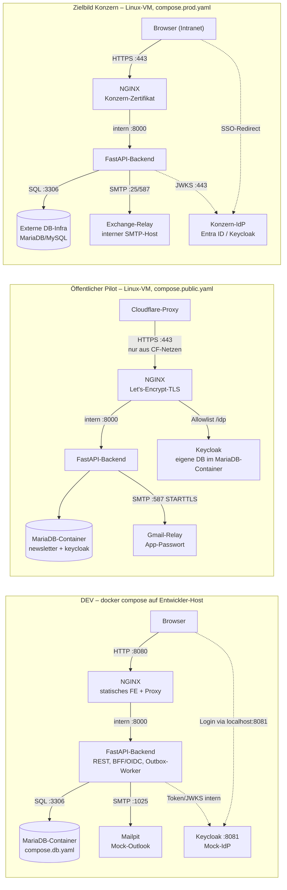

# Systemarchitektur „Störungsinfos“

## 1. Übersicht & Leitprinzip

Das Self-Service-Portal „Störungsinfos“ ersetzt manuelle Outlook-E-Mail-Verteiler durch eine datenbankgestützte Plattform. Mitarbeiter verwalten ihre Benachrichtigungsabonnements per Konzern-SSO selbst. Das zentrale Problemmanagement versendet Störungs- und Entwarnungsmeldungen über ein Web-Portal mit Live-Vorschau.

Die Anwendung selbst besteht aus zwei Containern: **NGINX** (TLS, statisches Frontend, Reverse Proxy) und **FastAPI** (REST, BFF/OIDC, Outbox-Worker). Alle Konzern-Systeme — IdP, SMTP-Relay, Datenbank — sind konfigurierbare Endpunkte. Wie viele Container tatsächlich laufen, hängt davon ab, welche dieser Endpunkte mitgeliefert werden: im Zielbild keine (nur NGINX + API), im DEV-Stack und im öffentlichen Pilot dagegen MariaDB, Keycloak und ein Mailserver als Container.

---

## 2. Container & Compose-Schichtung

Eine Codebasis, fünf Overlays — welche kombiniert werden, steuert das `Makefile` bzw. `deploy/vm/deploy.sh`:

| Datei | Inhalt | Zweck |
|---|---|---|
| `compose.yaml` | `nginx`, `api`, internes Netzwerk `appnet`, Healthchecks | Basis-Definition |
| `compose.db.yaml` | `mariadb` mit persistentem Volume `db_data` | DEV und PROD vor dem DB-Cutover |
| `compose.dev.yaml` | `keycloak` (Realm-Import), `mailpit`, `mariadb-test` (tmpfs) | DEV-Mocks & Test-Services |
| `compose.prod.yaml` | Resource-Limits, Log-Rotation, Restart-Policy, TLS-Mounts aus der Konzern-PKI | Zielbild Konzern |
| `compose.public.yaml` | Öffentlicher Pilot: Let's-Encrypt-Zertbot, Keycloak unter `/idp`, engere Speicherlimits | Demo-Instanz im Internet |

`compose.prod.yaml` und `compose.public.yaml` schließen sich aus — sie beschreiben zwei
verschiedene Betriebsformen derselben Anwendung.

---

## 3. Auth- & Session-Architektur (BFF-Muster)

* **Backend-for-Frontend (BFF)**: Der Browser verhandelt keine OAuth2-Tokens direkt. Der OIDC-Code-Exchange findet serverseitig im FastAPI-Backend statt.
* **Session-Cookie**: Der authentifizierte Zustand wird als verschlüsseltes, signiertes `HttpOnly`-Cookie (`session`) mit `SameSite=Lax` im Browser gespeichert — kein Session-Store.
* **CSRF-Schutz**: Bei allen mutierenden Endpunkten (`POST`, `PUT`, `PATCH`, `DELETE`) wird der Custom-Header `X-Requested-With: fetch` erzwungen (Schutz gegen Browser-Cross-Site-Requests).

---

## 4. Egress- / Ingress-Matrix (Firewall-Anträge)

Gilt für das Zielbild im Konzern. Der öffentliche Pilot weicht ab, wo vermerkt.

### Egress (ausgehend von der VM)

| Quelle | Ziel | Port/Protokoll | Zweck | Konfig-Variable | DEV-Ersatz |
|---|---|---|---|---|---|
| Backend | DB-Infra | 3306/TCP | MariaDB/MySQL (ab DB-Cutover) | `DATABASE_URL` | `mariadb` Container |
| Backend | Exchange-Relay | 25 / 587/TCP | SMTP-Versand | `SMTP_HOST` / `SMTP_PORT` | `mailpit` Container |
| Backend | Konzern-IdP | 443/TCP | OIDC-Discovery & JWKS | `OIDC_ISSUER_URL` | `keycloak` Container |
| VM (Build) | Docker Registry | 443/TCP | Base-Images (`nginx`, `python`) | `HTTPS_PROXY` | – |
| VM (Build) | PyPI Mirror | 443/TCP | Python-Abhängigkeiten (`pip`) | `HTTPS_PROXY` | – |
| VM (Pilot) | Let's Encrypt, Cloudflare-API | 443/TCP | Zertifikatsausstellung, IP-Bereichsliste | – | – |

### Ingress (eingehend zur VM)

| Quelle | Ziel | Port/Protokoll | Zweck |
|---|---|---|---|
| Browser (Intranet) | VM / NGINX | 443/TCP (+80 Redirect) | Frontend UI & REST API |
| Admin-Jumphost | VM | 22/TCP | SSH Maintenance & Deploy |

Im öffentlichen Pilot ist 443 auf die Cloudflare-Bereiche eingeschränkt und Port 80
bewusst für alle offen — die ACME-Prüfung von Let's Encrypt kommt nicht über Cloudflare.
Durchgesetzt wird das in einer eigenen iptables-Kette innerhalb von `DOCKER-USER`
(`deploy/vm/firewall.sh`), weil Docker veröffentlichte Ports per DNAT an ufw vorbeischleust.

---

## 5. Tragende Entscheidungen

Vollständig in [adr/](adr/); die drei mit der größten Wirkung auf den Betrieb:

* **DB-Cutover ist reine Konfiguration**: Der Wechsel von der lokalen Docker-DB auf die externe DB-Infrastruktur erfolgt über `DATABASE_URL` und das Weglassen von `compose.db.yaml`.
* **Null-Tracking** ([ADR-0014](adr/0014-null-tracking-und-retention.md)): keine Zählpixel, kein Klick-Tracking, keine Lesebestätigungen in versendeten Mails.
* **Topic-Pflege per SQL** ([ADR-0016](adr/0016-topic-pflege-ohne-admin-crud.md)): Verteiler werden über eine dokumentierte RUNBOOK-Prozedur gepflegt, nicht über eine Admin-CRUD-Oberfläche.
