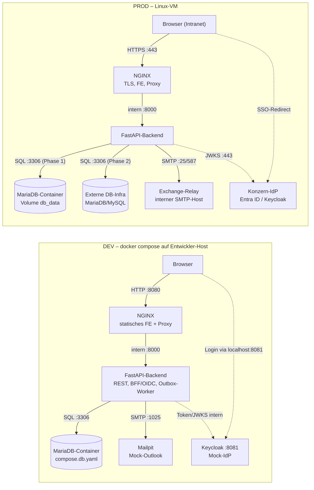

# Systemarchitektur „Störungsinfos“

## 1. Übersicht & Leitprinzip

Das Self-Service-Portal „Störungsinfos“ ersetzt manuelle Outlook-E-Mail-Verteiler durch eine datenbankgestützte Plattform. Mitarbeiter verwalten ihre Benachrichtigungsabonnements per Konzern-SSO selbst. Das zentrale Problemmanagement versendet Störungs- und Entwarnungsmeldungen über ein Web-Portal mit Live-Vorschau.

Das System läuft als Zwei-Container-Applikation (NGINX + FastAPI) auf einer Linux-VM. Alle externen Konzern-Systeme (IdP, Exchange SMTP-Relay, externe Datenbank) sind konfigurierbare Endpunkte und werden in DEV durch Docker-Container simuliert.

---

## 2. Container & Compose-Schichtung

Die Anwendung nutzt eine modular geschichtete Docker-Compose-Struktur:

| Datei | Inhalt | Zweck |
|---|---|---|
| `compose.yaml` | `nginx`, `api`, internes Netzwerk `appnet`, Healthchecks | Basis-Definition |
| `compose.db.yaml` | `mariadb` mit persistentem Volume `db_data` | DEV & PROD Phase 1 (lokale DB) |
| `compose.dev.yaml` | `keycloak` (Realm-Import), `mailpit`, `mariadb-test` (tmpfs) | DEV-Mocks & Test-Services |
| `compose.prod.yaml` | Resource-Limits, Log-Rotation, Restart-Policy, TLS-Mounts | PROD-Härtung |

---

## 3. Auth- & Session-Architektur (BFF-Muster)

* **Backend-for-Frontend (BFF)**: Der Browser verhandelt keine OAuth2-Tokens direkt. Der OIDC-Code-Exchange findet serverseitig im FastAPI-Backend statt.
* **Session-Cookie**: Der authentifizierte Zustand wird als verschlüsseltes, signiertes `HttpOnly`-Cookie (`session`) mit `SameSite=Lax` im Browser gespeichert.
* **CSRF-Schutz**: Bei allen mutierenden Endpunkten (`POST`, `PUT`, `DELETE`) wird der Custom-Header `X-Requested-With: fetch` erzwungen (Schutz gegen Browser-Cross-Site-Requests).

---

## 4. Egress- / Ingress-Matrix (Firewall-Anträge)

### Egress (ausgehend von der VM)

| Quelle | Ziel | Port/Protokoll | Zweck | Konfig-Variable | DEV-Ersatz |
|---|---|---|---|---|---|
| Backend | DB-Infra | 3306/TCP | MariaDB/MySQL (ab DB-Cutover) | `DATABASE_URL` | `mariadb` Container |
| Backend | Exchange-Relay | 25 / 587/TCP | SMTP-Versand | `SMTP_HOST` / `SMTP_PORT` | `mailpit` Container |
| Backend | Konzern-IdP | 443/TCP | OIDC-Discovery & JWKS | `OIDC_ISSUER_URL` | `keycloak` Container |
| VM (Build) | Docker Registry | 443/TCP | Base-Images (`nginx`, `python`) | `HTTPS_PROXY` | - |
| VM (Build) | PyPI Mirror | 443/TCP | Python-Abhängigkeiten (`pip`) | `HTTPS_PROXY` | - |

### Ingress (eingehend zur VM)

| Quelle | Ziel | Port/Protokoll | Zweck |
|---|---|---|---|
| Browser (Intranet) | VM / NGINX | 443/TCP (+80 Redirect) | Frontend UI & REST API |
| Admin-Jumphost | VM | 22/TCP | SSH Maintenance & Deploy |
| Monitoring | VM / NGINX | 443/TCP (`/readyz`) | Health Check Inspection |

---

## 5. Erweiterungspunkte & Architekturentscheidungen

* **Reine Konfigurationsänderung bei DB-Cutover**: Wechsel von lokaler Docker-DB auf externe DB-Infrastruktur erfolgt rein über `.env` und Weglassen von `compose.db.yaml`.
* **Null-Tracking**: Keine Zählpixel, kein Klick-Tracking, keine Lese-Bestätigungen in verschickten E-Mails.
* **Topic-Pflege per SQL**: CRUD für Topics erfolgt bewusst per SQL-Skript im RUNBOOK (ADR-016), um API-Komplexität im MVP zu minimieren.
