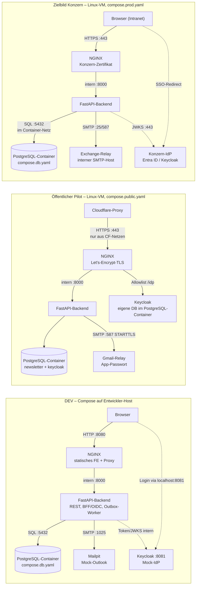

# Systemarchitektur „Störungsinfos“

## 1. Übersicht & Leitprinzip

Das Self-Service-Portal „Störungsinfos“ ersetzt manuelle Outlook-E-Mail-Verteiler durch eine datenbankgestützte Plattform. Mitarbeiter verwalten ihre Benachrichtigungsabonnements per Konzern-SSO selbst. Das zentrale Problemmanagement versendet Störungs- und Entwarnungsmeldungen über ein Web-Portal mit Live-Vorschau.

Die Anwendung besteht in jeder Umgebung aus drei Containern: **NGINX** (TLS, statisches Frontend, Reverse Proxy), **FastAPI** (REST, BFF/OIDC, Outbox-Worker) und **PostgreSQL** — die Datenbank läuft auch in PROD als Container auf derselben VM ([ADR-0030](adr/0030-postgresql-im-container-auch-in-prod.md)). IdP und SMTP-Relay sind konfigurierbare Endpunkte: im Zielbild Konzern-Systeme, im DEV-Stack Keycloak und Mailpit als Container, im öffentlichen Pilot Keycloak als Container und ein externes Mail-Relay.

---

## 2. Container & Compose-Schichtung

Eine Codebasis, fünf Overlays — welche kombiniert werden, steuert das `Makefile` bzw. `deploy/vm/deploy.sh`:

| Datei | Inhalt | Zweck |
|---|---|---|
| `compose.yaml` | `nginx`, `api`, internes Netzwerk `appnet`, Healthchecks | Basis-Definition |
| `compose.db.yaml` | `postgres` (eigenes Image mit Init-Skript) + persistentes Volume `pg_data` | Datenbank in jeder Umgebung: DEV, Pilot und PROD (ADR-0030) |
| `compose.dev.yaml` | `keycloak` (Realm-Import), `mailpit`, `postgres-test` (tmpfs) | DEV-Mocks & Test-Services |
| `compose.prod.yaml` | Resource-Limits, Log-Rotation, Restart-Policy, TLS-Mounts aus der Konzern-PKI, `PUBLIC_HOST` für den Serverblock | Zielbild Konzern |
| `compose.public.yaml` | Öffentlicher Pilot: Let's-Encrypt-Zertbot, Keycloak unter `/idp`, engere Speicherlimits | Demo-Instanz im Internet |

`compose.prod.yaml` und `compose.public.yaml` schließen sich aus — sie beschreiben zwei
verschiedene Betriebsformen derselben Anwendung.

---

## 3. Auth- & Session-Architektur (BFF-Muster)

* **Backend-for-Frontend (BFF)**: Der Browser verhandelt keine OAuth2-Tokens direkt. Der OIDC-Code-Exchange findet serverseitig im FastAPI-Backend statt.
* **Session-Cookie**: Der authentifizierte Zustand wird als verschlüsseltes, signiertes `HttpOnly`-Cookie (`session`) mit `SameSite=Lax` im Browser gespeichert — kein Session-Store.
* **CSRF-Schutz**: Bei allen mutierenden Endpunkten (`POST`, `PUT`, `PATCH`, `DELETE`) wird der Custom-Header `X-Requested-With: fetch` erzwungen (Schutz gegen Browser-Cross-Site-Requests).

---

## 4. Egress- / Ingress-Matrix (Firewall-Anträge)

Gilt für das Zielbild im Konzern. Der öffentliche Pilot weicht ab, wo vermerkt.

### Egress (ausgehend von der VM)

| Quelle | Ziel | Port/Protokoll | Zweck | Konfig-Variable | DEV-Ersatz |
|---|---|---|---|---|---|
| Backend | Exchange-Relay | 25 / 587/TCP | SMTP-Versand | `SMTP_HOST` / `SMTP_PORT` | `mailpit` Container |
| Backend | Konzern-IdP | 443/TCP | OIDC-Discovery & JWKS | `OIDC_ISSUER_URL` | `keycloak` Container |
| Backend | Konzern-DNS | 53/UDP+TCP | Namensauflösung (IdP, Relay) | – | DNS des Container-Netzes |
| Backend | Zeitserver (NTP) | 123/UDP | Systemzeit für TLS- und JWT-Prüfung (`exp`) | – | Host-Uhr |
| VM (Build) | Docker Hub (`registry-1.docker.io`, `auth.docker.io`; die Schichten liefert ein weiterer Host aus, am 2026-10-13 `production.cloudfront.docker.com` — nicht abschließend) | 443/TCP | Base-Images (`nginx`, `python`, `postgres`) | `HTTPS_PROXY` | – |
| VM (Build) | PyPI Mirror | 443/TCP | Python-Abhängigkeiten (`pip`) | `HTTPS_PROXY` | – |
| VM (Pilot) | Let's Encrypt, `www.cloudflare.com`, `api.ipify.org`, `quay.io`, `download.docker.com` (nicht abschließend) | 443/TCP | Zertifikatsausstellung, Cloudflare-IP-Bereichsliste, Anzeige der eigenen öffentlichen IP, Keycloak-Image, Docker-Installation | – | – |

Die Datenbank steht nicht in der Matrix: Backend und PostgreSQL-Container sprechen im
Container-Netz `appnet` derselben VM miteinander (5432/TCP), der Container veröffentlicht
keinen Host-Port. Die Verbindung verlässt die VM nicht und braucht keine Freischaltung —
auch in PROD ([ADR-0030](adr/0030-postgresql-im-container-auch-in-prod.md)).

Die Matrix gilt für Docker wie für Podman
([ADR-0033](adr/0033-container-engine-docker-oder-podman.md)): Die Engine ändert keine
Verbindung und keinen Port. Unter Podman ohne Root-Rechte sieht NGINX allerdings nicht
die Adresse des Clients (RUNBOOK 1b).

Nicht für die VM, nur für Entwicklerrechner und CI: `registry.npmjs.org` (Testwerkzeug der
Frontend-Tests), für `npm audit signatures` (RUNBOOK 5c) zusätzlich
`tuf-repo-cdn.sigstore.dev`, in der CI zusätzlich `cdn.playwright.dev` (Chromium zur
gepinnten Playwright-Version; leitet auf weitere Download-Hosts weiter, am 2026-10-07
`storage.googleapis.com` und `playwright.download.prss.microsoft.com`) sowie die
Paketquellen des Runners (`--with-deps` ruft `apt-get` mit Root-Rechten auf) —
[ADR-0029](adr/0029-frontend-verhaltenstests-mit-playwright.md).

Ebenfalls nur auf Entwicklerrechnern, für `make governance` (Stücklisten und
Schwachstellenbericht, RUNBOOK 5b): die Registry des Scanner-Image (`aquasec/trivy` auf
Docker Hub), für dessen Schwachstellen-Datenbank `mirror.gcr.io` — ersatzweise `ghcr.io` mit
`pkg-containers.githubusercontent.com` —, `pypi.org` und `files.pythonhosted.org` für das
Werkzeug der Stückliste sowie die Registries der Basis-Images (Docker Hub, `quay.io`) für
die Abfrage, ob ein neueres vorliegt — das Skript fragt selbst und beachtet `HTTPS_PROXY`. Der Scan selbst läuft ohne Netz; das Skript lädt kein
Image und kein Ergebnis hoch.

### Ingress (eingehend zur VM)

| Quelle | Ziel | Port/Protokoll | Zweck |
|---|---|---|---|
| Browser (Intranet) | VM / NGINX | 443/TCP (+80 Redirect) | Frontend UI & REST API |
| Admin-Jumphost | VM | 22/TCP | SSH Maintenance & Deploy |

Im öffentlichen Pilot ist 443 auf die Cloudflare-Bereiche eingeschränkt und Port 80
bewusst für alle offen — die ACME-Prüfung von Let's Encrypt kommt nicht über Cloudflare.
Durchgesetzt wird das in einer eigenen iptables-Kette innerhalb von `DOCKER-USER`
(`deploy/vm/firewall.sh`), weil Docker veröffentlichte Ports per DNAT an ufw vorbeischleust.

---

## 5. Tragende Entscheidungen

Vollständig in [adr/](adr/); die mit der größten Wirkung auf den Betrieb:

* **Datenbank im Container, auch in PROD** ([ADR-0030](adr/0030-postgresql-im-container-auch-in-prod.md)): PostgreSQL läuft auf derselben VM wie die Anwendung; ein Umzug auf eine externe Datenbank ist nicht geplant. Sicherung und Wiederherstellung ([RUNBOOK 3](RUNBOOK.md)) sowie Patches und Versions-Upgrades von PostgreSQL liegen damit beim Betrieb der Anwendung, nicht bei einem Datenbank-Team.
* **„Versand anlegen“ ist wiederholbar** ([ADR-0031](adr/0031-idempotenter-versand-aufruf.md)): Mit `idempotency_key` legt ein wiederholter Aufruf keinen zweiten Versand an; den Ausschluss leistet ein eindeutiger Index in `dispatches`. Ohne Schlüssel greift der Schutz nicht.
* **Null-Tracking** ([ADR-0014](adr/0014-null-tracking-und-retention.md)): keine Zählpixel, kein Klick-Tracking, keine Lesebestätigungen in versendeten Mails. Empfängeradressen bleiben aus den Logs — je Log anders gelöst: Die Anwendung ersetzt in Meldung und Traceback, was wie eine Adresse aussieht (`core/logging.py`); NGINX schreibt das Access-Log ohne Query-String und für den Suchpfad `/api/v1/admin/users` kein Fehlerlog (`app-locations.inc`); PostgreSQL startet mit `log_error_verbosity=terse` und `log_min_error_statement=panic` (`compose.db.yaml`, wiederholt in `compose.public.yaml`; die Grenze bei von Hand eingegebenem SQL nennt ADR-0030).
* **Verteiler-Pflege in der Oberfläche** ([ADR-0024](adr/0024-verteiler-crud-in-der-oberflaeche.md), löst ADR-0016 ab): Anlegen, Umbenennen, Deaktivieren und Löschen laufen über die Admin-Maske; der Slug bleibt unveränderlich und Verteiler mit Versandhistorie sind nur deaktivierbar. Das SQL aus [RUNBOOK 6](RUNBOOK.md) bleibt als Notfallweg — ohne Audit-Eintrag.
* **Adminrechte gehören dem Portal** ([ADR-0022](adr/0022-adminrechte-im-portal.md)): allein `users.is_admin`, bei **jeder** Anfrage aus der Datenbank gelesen — ein Entzug wirkt daher sofort statt erst mit dem Cookie-Ablauf. Rollen aus dem IdP-Token werden nicht ausgewertet; der IdP liefert Identität, das Portal Berechtigung. Kehrseite für den Betrieb: Eine Deaktivierung im Verzeichnisdienst entzieht das Adminrecht nicht von selbst.
