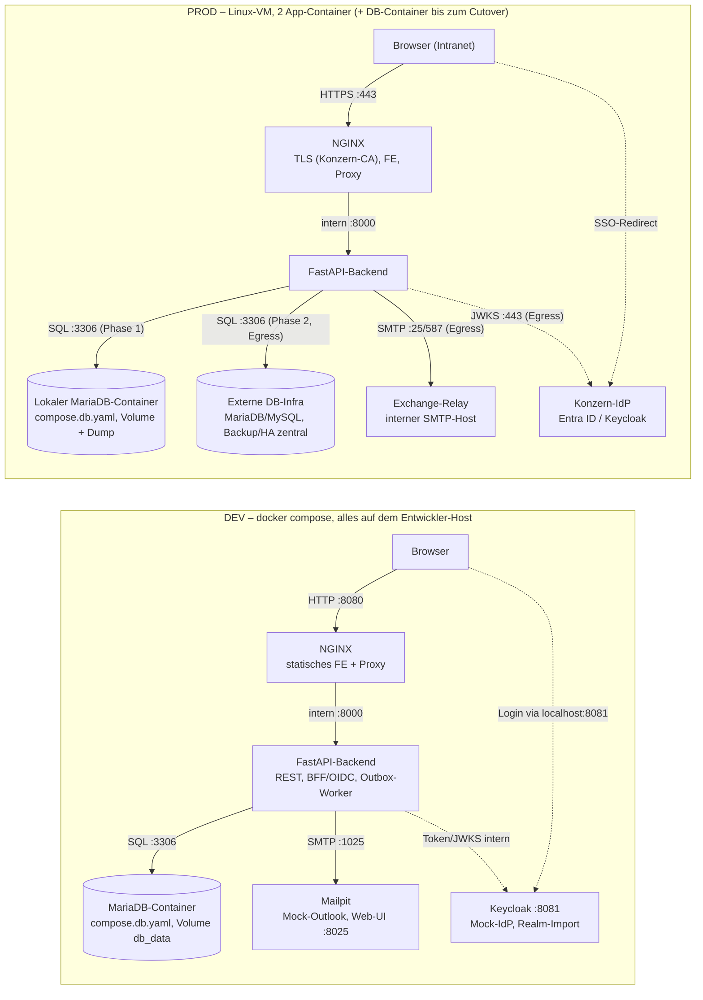
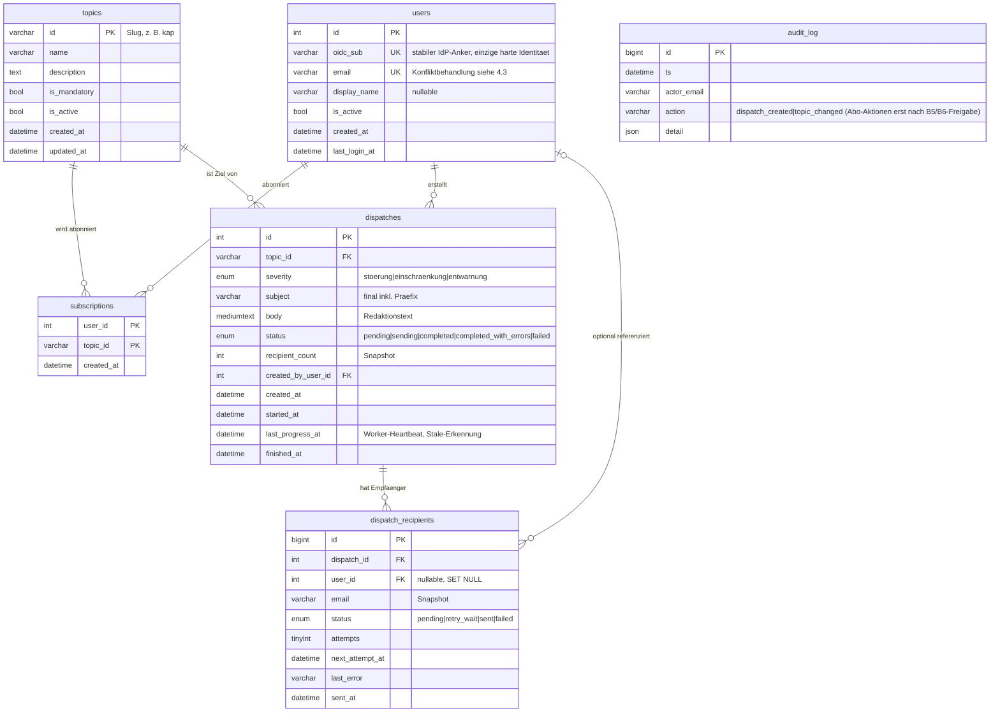
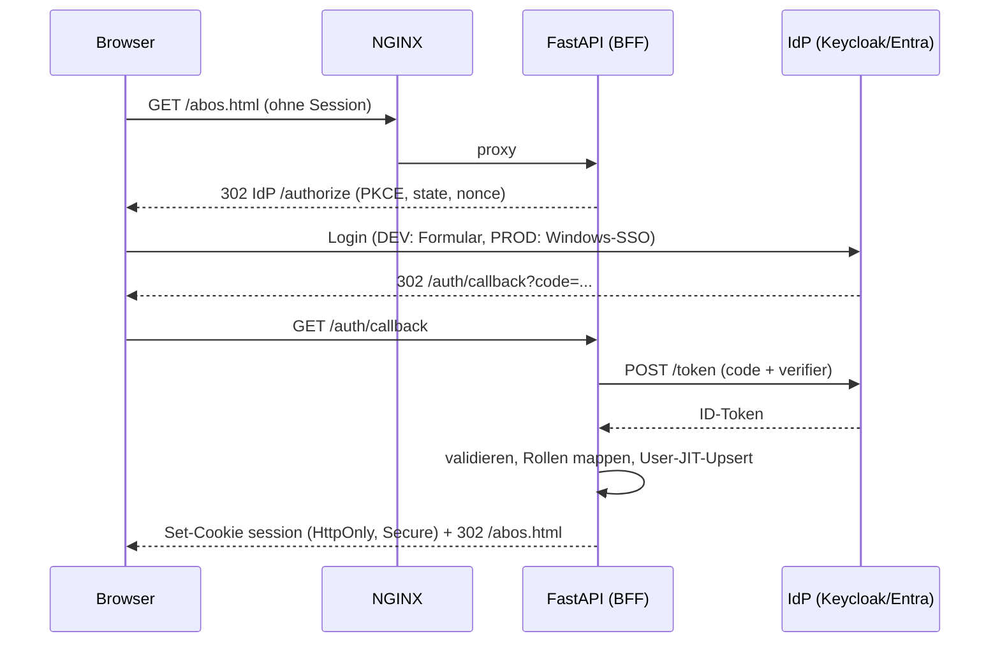
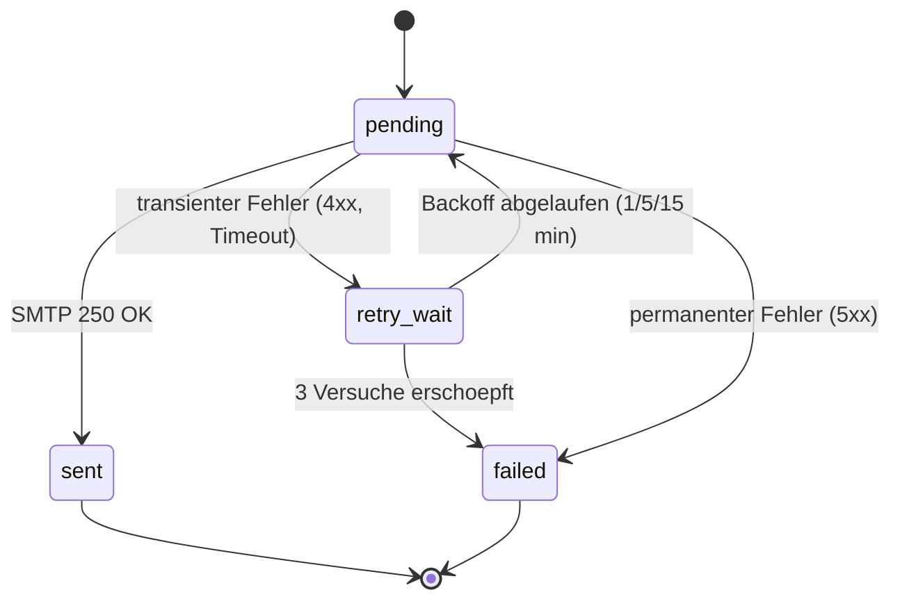
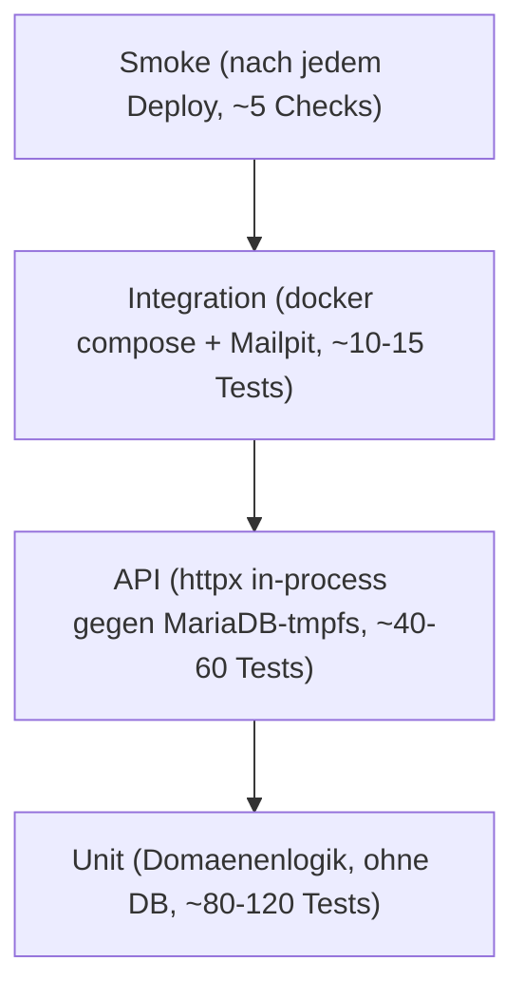

# MVP-Umsetzungsplan „Störungsinfos“ — Self-Service-Portal für Störungs-Newsletter

**Version:** 1.2 · **Planungsstand:** 2026-08-10 · **Status:** historisch

> **Dieses Dokument ist der Plan von vor der Umsetzung, nicht die Beschreibung des
> Ist-Stands.** Es bleibt erhalten, weil es die Anforderungen, die Abwägungen und die
> Meilenstein-Logik festhält, aus denen das System entstanden ist. Wo Plan und Realität
> auseinandergehen, gilt die Realität — nachzulesen in [README](../README.md),
> [ARCHITECTURE](ARCHITECTURE.md), [RUNBOOK](RUNBOOK.md), [adr/](adr/) und
> [CHANGELOG](../CHANGELOG.md).
>
> Die auffälligsten Abweichungen: handgeschriebenes CSS statt Tailwind (ADR-0018),
> aiomysql statt asyncmy (ADR-0019), Keycloak läuft im Pilot dauerhaft mit statt nur in
> DEV, Selbstregistrierung über den IdP (ADR-0021), kein automatisierter Notfall-CSV-Export,
> SMTP-Auth nur `none`/`login` (ADR-0012). Die Personentage-Angaben in Abschnitt 11 sind
> Schätzungen aus der Planung und wurden nicht nachgeführt.

---

## 1. Executive Summary

Das zentrale Problemmanagement versendet Störungs- und Entwarnungs-Mails heute über händisch gepflegte Outlook-Verteiler. Dieses Projekt ersetzt sie durch ein **Self-Service-Portal**: Jeder Mitarbeiter meldet sich per Konzern-SSO an und pflegt seine Abos selbst; alle Verteiler werden datenbankgestützte **Topics**, das Problemmanagement versendet über eine Web-Maske mit Live-Vorschau.

Die Lösung besteht aus zwei App-Containern (NGINX mit statischem HTML/Tailwind-Frontend, FastAPI-Backend mit REST-API und DB-gestützter Versand-Outbox) auf **einer Linux-VM**. Die Datenbank läuft — wie vom Auftraggeber vorgegeben — **vorläufig als dritter Container mit persistentem Volume auf derselben VM** und wandert später per reiner Konfigurationsänderung auf die zentrale DB-Infrastruktur. Alles, was der Konzern stellt — Datenbank (MariaDB/MySQL), IdP (Entra ID/Keycloak), Exchange-Relay — ist aus Sicht der App ein **konfigurierter Endpunkt**: In der Entwicklung simulieren Compose-Container (MariaDB, Keycloak, **Mailpit** als „Mock-Outlook“) dieselben Endpunkte; der Wechsel auf die Konzern-Infrastruktur ist ausschließlich eine `.env`-Änderung. Unklare Vorgaben (Relay-Auth „Kerberos oder so“, DSGVO/Betriebsrat, Firewall, Change-Prozesse) werden nicht geraten, sondern hinter Konfiguration, schmalen Adaptern und dokumentierten Erweiterungspunkten abstrahiert.

**Meilensteine in einem Satz:** M0 stellt das lauffähige Docker-Gerüst mit Mocks und CI bereit, M1 liefert SSO-Login und Datenmodell, M2 die Abo-Maske, M3a den Happy-Path-Versand inklusive Versand-Maske, M3b die Versand-Robustheit, M4 Härtung, vollständige Test-Suite und Betriebsreife, M5 die Anbindung an die echte Konzern-Infrastruktur und den Pilotbetrieb — insgesamt ca. **42 Personentage**.

---

## 2. Ziele, Nicht-Ziele & Leitplanken

### 2.1 Ziele (MVP-Scope)

| # | Ziel | Messbar durch |
|---|---|---|
| Z1 | Mitarbeiter verwalten ihre Abos selbst (Abo-Maske mit Toggles, Pflicht-Topic gesperrt) | Abnahmetest Abo-Maske |
| Z2 | Problemmanagement versendet Störungs-/Einschränkungs-/Entwarnungs-Mails über die Versand-Maske mit Live-Vorschau | End-to-End-Versand gegen Mailpit |
| Z3 | Login ausschließlich per Konzern-SSO (OIDC), keine eigene Passwortverwaltung | Login-Roundtrip DEV (Keycloak) |
| Z4 | Vollständig dockerisiert, Deployment auf einer Linux-VM, robust gegen Container-Crash und VM-Reboot | Runbook-Prozedur + Restart-Test |
| Z5 | DB, IdP und SMTP-Relay per Konfiguration umschaltbar (DEV-Mock ↔ lokale Docker-DB ↔ Konzern-Infrastruktur) | `.env`-Wechsel ohne Code-Change |
| Z6 | Versand nachvollziehbar: wer wurde wann mit welchem Inhalt angeschrieben, mit welchem Ergebnis | Versandhistorie + `dispatch_recipients` |
| Z7 | Test-Suite (Unit/API/Integration/Smoke) und gepflegte Doku (README, ARCHITECTURE, RUNBOOK, ADRs) als Definition of Done | `make check` grün, Doku-Gates |

### 2.2 Nicht-Ziele (bewusst ausgeklammert, mit benanntem Erweiterungspunkt)

| Nicht im MVP | Erweiterungspunkt |
|---|---|
| Kerberos/GSSAPI am SMTP-Relay | Mailer-Adapter `SMTP_AUTH_MODE=kerberos` (nur bei Bestätigung durch Exchange-Team) |
| Verzeichnis-Sync (AD/SCIM), Erreichen nicht angemeldeter Mitarbeiter | Sync-Job, der nur zusätzliche `users`-Zeilen erzeugt |
| Message-Queue (Celery/Redis), HA, mehrere Replikas | Worker-Container auf derselben Outbox (`SKIP LOCKED`); bis dahin: dokumentierte **Notfall-Versand-Prozedur** (9.6) + Parallelbetrieb Alt-Verteiler als Fallback |
| Bounce-/NDR-Auswertung, Lese-/Klick-Tracking | Sammelpostfach im MVP; Tracking bewusst **nie** (Betriebsrat) |
| Rich-Text-Editor, Versand-Abbruch, Entwurfsstatus | `cancel`-Endpunkt, `draft`-Status — Statusmodell trägt beides |
| Admin-UI für Topic-Verwaltung (CRUD) | Topics entstehen per Seed-Migration, Änderungen per RUNBOOK-SQL-Prozedur; volles Topic-CRUD (API **und** UI zusammen) als benannter Erweiterungspunkt (ADR-016) |
| Revisionssichere Archivierung der gerenderten Mail | `rendered_html`-Spalte + Template-Version |
| Verschlüsselung der Backup-Dumps | age/gpg mit Betriebs-Key, sobald B6/B7 die Anforderung ergeben |
| WCAG-/BITV-Audit, Lasttests, Browser-E2E | nach MVP, Trigger dokumentiert (Abschnitt 8) |
| Dashboards/Newsfeed über die Störungshistorie (Wunsch des Auftraggebers) | `dispatches` ist die fertige Datenquelle (4.3): Read-only-Endpunkt oder DB-View als weiterer API-Konsument; `related_dispatch_id` verknüpft Entwarnung ↔ Störung (additive Migration) |

### 2.3 Leitplanken

1. **Einfachheit ist Anforderung, nicht Stilfrage.** Keine Infrastrukturkomponente ohne ADR; die einfachste Lösung, die funktioniert, gewinnt (kein SPA-Framework, kein Broker, kein Session-Store). Das gilt auch nach innen: **keine zwei Mechanismen für dasselbe Ziel** (ein Test-DB-Dialekt, eine Konfig-Wahrheit, ein CSRF-Schutz).
2. **Unklares wird abstrahiert, nicht geraten.** Regulatorik (DSGVO, Betriebsrat, Retention) und Netzwerk (Firewall, Proxy, Relay-Auth) sind offen → jede plausible spätere Vorgabe muss als **Konfigwert, SQL-Skript oder kleines Feature** erfüllbar sein, nie als Architekturumbau.
3. **Ein Stack, zwei Umgebungen.** Kein Code-Unterschied DEV/PROD; nur die `.env` (und die Compose-Overlay-Auswahl) unterscheidet sich.
4. **Doku ist Teil der Definition of Done.** README, ARCHITECTURE (inkl. Egress-/Ingress-Matrix), RUNBOOK und ADRs werden bei jedem Change mitgepflegt — mechanisch verankert (Abschnitt 9), nicht als Appell.
5. **Datenminimierung und Null-Tracking von Anfang an** — die billigste Betriebsrats- und DSGVO-Vorsorge (Abschnitt 10).

---

## 3. Systemarchitektur

### 3.1 Leitprinzip

Der Kern besteht in **jeder** Umgebung aus zwei eigenen Containern: **NGINX** (TLS-Terminierung, statisches Frontend, Reverse Proxy) und **FastAPI-Backend** (REST-API, OIDC/BFF, async Mail-Worker). DB, IdP und Relay sind konfigurierte Endpunkte — in DEV durch Compose-Services simuliert, in PROD echte Konzern-Systeme. **Die Datenbank durchläuft dabei planmäßig zwei Phasen:** PROD startet — der Vorgabe entsprechend — mit einem lokalen MariaDB-Container samt Named Volume (eigenes Compose-Overlay `compose.db.yaml`); der Cutover auf die zentrale DB-Infrastruktur ist eine `DATABASE_URL`-Änderung plus Weglassen des Overlays (Prozedur 9.4).



### 3.2 Container & Compose-Schichtung

Eine Codebasis, **vier** Compose-Dateien — bewusst **keine** getrennten Stacks, damit die Basis-Definition der App-Container garantiert identisch ist. Die DB liegt in einem eigenen Overlay, damit die vom Auftraggeber vorgegebene Übergangsphase „PROD mit Docker-DB + Volume“ ein regulärer, startbarer Zustand ist und kein improvisierter:

| Datei | Inhalt | Genutzt in |
|---|---|---|
| `compose.yaml` | Basis: `nginx`, `api`, internes Netz `appnet`, Healthchecks | DEV + PROD |
| `compose.db.yaml` | `mariadb` mit Named Volume `db_data`, Healthcheck, `restart: unless-stopped`, **keine Host-Ports** | DEV immer; PROD bis zum DB-Cutover |
| `compose.dev.yaml` | Mocks: `keycloak` (Realm-Import), `mailpit`, `mariadb-test` (tmpfs, für `make test-db`); Port-Mappings, Live-Reload-Mounts | nur DEV |
| `compose.prod.yaml` | `restart: unless-stopped`, Ressourcen-Limits, TLS-Mounts, Log-Rotation, Version-Tags | nur PROD |

Aufruf gekapselt per Makefile: `make dev` (Basis + db + dev), `make prod-localdb` (Basis + db + prod — **der Go-Live-Zustand**), `make prod` (Basis + prod — nach DB-Cutover). Der Cutover ist damit konsistent: `DATABASE_URL` ändern + DB-Overlay weglassen, sonst nichts.

| Service | Image | Rolle | Healthcheck | DEV | PROD |
|---|---|---|---|---|---|
| `nginx` | eigenes Image auf `nginx:stable-alpine` (per Digest gepinnt), Frontend eingebacken | TLS, Statik, Proxy für `/api/*`, `/auth/*`, `/healthz`, `/readyz` | eigener lokaler Stub `GET /nginx-health` (`return 200`) — **nicht** ans Backend gekoppelt | Port 8080, ohne TLS | 80→443-Redirect, 443 mit Konzern-Zertifikat (ro-Mount) |
| `api` | eigenes Image auf `python:3.12-slim` (per Digest gepinnt) | REST, BFF/OIDC, Outbox-Worker, Alembic beim Start; **fest `workers=1`** (6.3) | `GET /healthz` (nur Liveness — ein Relay-Ausfall darf den Container nicht „unhealthy“ machen; `/readyz` ist dem externen Monitoring vorbehalten) | Code-Mount + Reload | immutable, Tag aus `.env` |
| `mariadb` *(compose.db.yaml)* | `mariadb:11` | DB (DEV + PROD-Phase 1) | `healthcheck.sh --connect` | Volume `db_data` | Volume `db_data` + nächtlicher Dump (9.3); entfällt nach Cutover |
| `keycloak` *(nur DEV)* | `quay.io/keycloak/keycloak:26` | Mock-IdP; `KC_HTTP_PORT=8081`, `KC_HOSTNAME=localhost`, `KC_HEALTH_ENABLED=true`; Realm/Testuser/Rollen als versioniertes JSON | `/health/ready` auf **Management-Port 9000** | Port-Mapping 8081:8081 | entfällt (OIDC-Vars → Konzern-IdP) |
| `mailpit` *(nur DEV)* | `axllent/mailpit` | Mock-Outlook: SMTP-Sink, Web-UI, REST-API für Test-Assertions, Fehler-Injektion („Chaos“) | `/livez` | SMTP 1025, UI 8025 | entfällt (SMTP-Vars → Relay) |

`depends_on` mit `condition: service_healthy` sorgt in DEV für sauberen Start. Nur `nginx` publiziert Ports (DEV zusätzlich Mailpit-UI und Keycloak); `api` und `mariadb` sind von außen unerreichbar, die DB wird bewusst **nicht** auf den Host gemappt.

### 3.3 Robustheit & Betriebseigenschaften

- **Zustandslosigkeit:** App-Container haben keine Volumes; der gesamte Zustand liegt in der DB (lokal im `db_data`-Volume bzw. später extern). App-Container sind wegwerfbar, Rollback ist ein Image-Tag.
- **Restart:** PROD `restart: unless-stopped` + `systemctl enable docker` → überlebt Crash und Reboot ohne eigene systemd-Unit (eine Start-Mechanik weniger; dünne oneshot-Unit als dokumentierter Erweiterungspunkt).
- **Health:** `GET /healthz` (Liveness, ohne Abhängigkeiten, enthält Version/Git-SHA) getrennt von `GET /readyz` (DB `SELECT 1`, Outbox-Rückstau-Alter, SMTP-TCP-Check 60 s gecacht, Zertifikats-Restlaufzeit). **Der Container-Healthcheck zeigt ausschließlich auf `/healthz`** — fachliche Degradation (Relay down, Rückstau) macht den Container nicht „unhealthy“ und löst keine Restart-Schleifen oder blockierten `depends_on`-Starts aus; `/readyz` konsumiert nur das externe Monitoring (9.3).
- **Logging:** beide Container JSON auf stdout/stderr (12-Factor); Rotation via Docker `json-file`-Driver (`max-size: 10m`, `max-file: 5`). Zentrales Konzern-Logging später rein per Log-Driver — kein Code-Change. Jeder Request trägt eine Request-ID. **Logs enthalten keine Empfänger-Mailadressen** (Datenminimierung gilt auch für Logs; Referenz auf `dispatch_id`/`recipient_id` genügt zur Diagnose) — das ist zugleich Vorarbeit für die Betriebsratsvorlage (Frage B5).
- **Ressourcen-Limits (PROD):** `api` 1 CPU / 512 MB, `nginx` 0.5 CPU / 128 MB — großzügig fürs Lastprofil, verhindert aber, dass ein Leck die VM reißt.
- **Härtung:** Non-Root-User in beiden Images, `read_only`-Root-FS mit `tmpfs` für Laufzeitpfade — billig, in Security-Reviews viel wert. Patch-/CVE-Management der Images: Abschnitt 9.7.

### 3.4 Konfigurationsprinzip: eine `.env`, validiert beim Start

Genau eine `.env` pro Umgebung; gelesen von Compose (Substitution) und vom Backend (**pydantic-settings** — fehlende Pflichtvariable = lauter Startfehler statt späterem leisen Fehlverhalten). **Die versionierte, vollständig kommentierte `.env.example` ist die einzige Wahrheit über Konfiguration** (je Variable: Pflicht/Default, Beschreibung, DEV-/PROD-Beispiel im Kommentar); das README verlinkt nur darauf, statt eine zweite Tabelle zu pflegen. Ein triviales CI-Gate prüft, dass jedes Feld des pydantic-Settings-Objekts in `.env.example` vorkommt (aus dem Settings-Objekt generierbar — kein Markdown-Parser, keine Duplikat-Pflege; ersetzt das ursprünglich angedachte Tabellen-Abgleich-Gate, das nur eine selbstgeschaffene Duplikation überwacht hätte). Die reale `.env` liegt mit `chmod 600` auf der VM.

| Variable | DEV-Beispiel | PROD | Zweck |
|---|---|---|---|
| `APP_ENV` | `dev` | `prod` | Feature-Schalter (Debug, OpenAPI-UI) |
| `PUBLIC_BASE_URL` | `http://localhost:8080` | `https://stoerungsinfo.konzern.example` | Redirect-URIs, Footer-Link |
| `IMAGE_TAG` | `local` | `v0.4.0` | Deploy-/Rollback-Hebel |
| `DATABASE_URL` | `mysql+asyncmy://app:…@mariadb:3306/newsletter` | Phase 1: `…@mariadb:3306/…`, Phase 2: externer DB-Host | **der** DB-Umschalter |
| `OIDC_ISSUER_URL` | `http://localhost:8081/realms/dev` | Konzern-Issuer | Issuer/`iss`-Prüfung, Browser-Redirects |
| `OIDC_INTERNAL_BASE_URL` | `http://keycloak:8081` | leer (= Issuer-URL) | Backend-seitige Discovery/Token/JWKS-Calls (Split-Horizon DEV, 5.5) |
| `OIDC_CLIENT_ID` / `OIDC_CLIENT_SECRET` | `newsletter-dev` / … | von Konzern-IT | App-Registrierung |
| `OIDC_EMAIL_CLAIM` | `email` | ggf. `preferred_username` | Claim-Flexibilität IdP |
| `OIDC_ROLES_CLAIM` | `realm_access.roles` | z. B. `roles` (Entra App-Rollen) | Claim-Flexibilität IdP |
| `ADMIN_ROLE_VALUE` | `stoerungsinfo-admin` | App-Rolle/Gruppe der Konzern-IT | Zugriff Versand-Maske |
| `SESSION_SECRET` / `SESSION_MAX_AGE` | Zufall / `28800` | Zufall / 8 h | BFF-Session-Cookie; Secret-Tausch = Notfall-Session-Invalidierung (9.5) |
| `SMTP_HOST` / `SMTP_PORT` | `mailpit` / `1025` | Relay / `25` oder `587` | Mailversand |
| `SMTP_SECURITY` | `none` | `none`\|`starttls`\|`ssl` | Transportverschlüsselung |
| `SMTP_AUTH_MODE` | `none` | `none`\|`login` (`kerberos` reserviert) | Relay-Auth-Abstraktion |
| `SMTP_USER` / `SMTP_PASSWORD` | – | nur bei `login` | Credentials |
| `MAIL_FROM` / `MAIL_FROM_NAME` | `stoerungsinfo@dev.local` / `Störungsinfo (DEV)` | Funktionsadresse / `Zentrales Problemmanagement` | Absender |
| `SMTP_MAX_PER_MINUTE` / `SMTP_BATCH_SIZE` / `SMTP_TIMEOUT_S` | `0` / `100` / `10` | z. B. `600` / `100` / `30` | Drossel, Verbindungs-Reuse, Timeout |
| `RETENTION_DAYS_RECIPIENTS` / `RETENTION_DAYS_AUDIT` | leer (= aus) | nach Regulatorik-Klärung | Cleanup-Job (Abschnitt 10) |
| `AUDIT_SUBSCRIPTIONS` | `false` | `false` bis B5/B6-Freigabe | Schalter für Abo-Änderungs-Protokollierung (4.3) |
| `HTTPS_PROXY` / `NO_PROXY` | leer | nach Konzern-Vorgabe | JWKS über Zwangs-Proxy |
| `SSL_CERT_FILE` | – | `/etc/ssl/certs/corp-ca.pem` (ro-Mount) | interne Konzern-CA |
| `TLS_CERT_PATH` / `TLS_KEY_PATH` | – | ro-Mounts für NGINX | Serverzertifikat |
| `LOG_LEVEL` | `DEBUG` | `INFO` | Logging |

### 3.5 Frontend-Entscheidung: statisches HTML + Tailwind, kein SPA

Zwei statische Seiten (Abo-Maske, Versand-Maske) plus eine statische Datenschutzhinweis-Seite (10.1) als plain HTML mit **vorkompiliertem Tailwind (Standalone-CLI, kein npm)** und Vanilla-JS `fetch` gegen die REST-API, beim Image-Build ins NGINX-Image kopiert. Begründung: zwei Masken und eine Handvoll API-Calls rechtfertigen keine SPA-Build-Pipeline; kein Node zur Laufzeit, keine CDN-Abhängigkeit (firewall-freundlich), vollständig lesbarer Code. **Proxy-Sicherheit des Builds:** Das gebaute `app.css` wird als Build-Artefakt **mit versioniert** — der Image-Build auf der VM braucht damit weder Node noch GitHub-Zugang (das Tailwind-CLI-Binary wird nur auf Entwickler-Maschinen benötigt; Bezugsweg im README dokumentiert). Die REST-API ist der stabile Vertrag — ein späteres SPA konsumiert dieselbe API, ohne dass Backend oder NGINX-Routing sich ändern (ADR-006).

### 3.6 Repo-Struktur (Monorepo)

```
kundeninfo-newsletter/
├── README.md                  # Quickstart <15 min, Link auf .env.example (Konfig-Wahrheit), Troubleshooting (DoD!)
├── CHANGELOG.md               # Keep-a-Changelog
├── CONTRIBUTING.md            # DoD, PR-Checkliste, Regel "Migrationen nur additiv"
├── CLAUDE.md                  # Leitplanken für KI-gestützte Entwicklung
├── .env.example               # versioniert, vollständig kommentiert = einzige Konfig-Wahrheit
├── compose.yaml / compose.db.yaml / compose.dev.yaml / compose.prod.yaml
├── Makefile                   # dev, prod, prod-localdb, lint, test, test-db, test-integration, seed, smoke, scan, check
├── backend/
│   ├── Dockerfile
│   ├── pyproject.toml
│   ├── app/
│   │   ├── main.py            # App-Factory create_app(settings)
│   │   ├── api/               # Router: me, topics, subscriptions, admin (dispatches)
│   │   ├── core/              # config (pydantic-settings), oidc/session, logging
│   │   ├── domain/            # Empfängerauflösung, Pflicht-Topic-Regeln (reine Logik)
│   │   ├── db/                # SQLAlchemy-Modelle, Session, alembic/
│   │   ├── mail/              # Mailer-Interface, SMTP-Adapter, Jinja2-Templates, Worker
│   │   └── seed.py            # kanonischer Seed (Topics + Demo-User)
│   ├── tests/                 # unit/ api/ integration/ + conftest.py + keys/ (Test-JWKS)
│   └── scripts/smoke.py
├── frontend/
│   ├── public/                # index.html, abos.html, versand.html, datenschutz.html, app.js
│   │   └── assets/app.css     # gebautes Tailwind-CSS, versioniert (proxy-sicherer VM-Build)
│   ├── src/styles.css         # Tailwind-Input
│   └── build.sh               # Tailwind-Standalone-CLI (nur Entwickler-Maschine)
├── deploy/
│   ├── nginx/                 # Dockerfile, nginx.conf, conf.d/app.conf (inkl. /nginx-health-Stub)
│   ├── keycloak/realm-dev.json
│   └── vm/                    # VM-Setup-Notizen
├── ops/
│   ├── backup.sh              # nächtlicher mysqldump (DB-Volume-Phase, DEV + PROD Phase 1)
│   ├── export-recipients.sh   # Notfall-Versand: Empfängerlisten je Topic als CSV (9.6)
│   └── check-egress.sh        # Vorab-Test der Firewall-Freischaltungen
└── docs/
    ├── ARCHITECTURE.md        # Diagramme, Datenfluss, Egress-/Ingress-Matrix (DoD!)
    ├── RUNBOOK.md             # Deploy, Update, Rollback, Backup/Restore, Störungen, DB-Cutover,
    │                          #   Notfall-Versand, Secret-/Zertifikatslebenszyklus, Image-Rebuild, Topic-Pflege
    ├── dsgvo-operations.md    # Auskunft-/Lösch-SQL (Abschnitt 10)
    ├── betriebsrat-briefing.md# Null-Tracking & Datenmodell mit Personenbezug, Argumentationsunterlage (B5)
    ├── open-questions.md      # lebendes Fragenregister mit Nummern, Datum, Quelle
    └── adr/                   # 0000-template.md, 0001-… (Abschnitt 14)
```

### 3.7 Deployment auf der Linux-VM

**Einmalig:** Anwendungs-Registrierung (CMDB/App-ID, Namenskonventionen — Frage B9, Vorbedingung vieler Anträge), Docker Engine + Compose-Plugin, DNS-Name, Zertifikat der Konzern-CA, Firewall-Freischaltungen laut Egress-/Ingress-Matrix, Deploy-User in `docker`-Gruppe.

**Regel-Deployment (technische Durchlaufzeit < 5 Minuten; die reale Taktung bestimmt der Konzern-Change-Prozess):** In Konzernen laufen PROD-Deployments üblicherweise über Change-Management (CAB/Standard-Change, Wartungsfenster). Ziel ist, Deployments früh als **vorabgenehmigten Standard-Change** zu qualifizieren — das dokumentierte Rollback- und Smoke-Konzept dieses Plans ist genau das Argument dafür (Frage B9). Ablauf:

1. **Image-Bezug:** Solange Registry-/CI-Zugang ungeklärt ist, werden Images **auf der VM aus dem annotierten Git-Tag gebaut** (`git checkout vX.Y.Z && docker compose build`; Version + Git-SHA werden als Build-Args ins Image und in `/healthz` gestempelt; Base-Images per Digest gepinnt). Sobald eine Konzern-Registry verfügbar ist, baut CI und die VM zieht nur noch (`IMAGE_TAG` + `compose pull`) — der Wechsel ist im Makefile vorbereitet (ADR-008).
2. `make prod-localdb` (bzw. nach DB-Cutover `make prod`) — das Backend führt beim Start `alembic upgrade head` aus (MVP: automatisch, da Single-Instance; expliziter Migrationsschritt als Erweiterungspunkt bei Replikas/DBA-Prozessen).
3. Smoke-Test: `make smoke BASE_URL=https://…` (Abschnitt 8.5) + Testmail an ein Kontrollpostfach.
4. **Rollback:** vorheriger Tag + `up -d`. Möglich, weil Migrationen **nur additiv** sein dürfen (Regel in CONTRIBUTING.md); sonst Restore aus dem letzten Dump.

Kein `:latest` in Produktion; die laufende Version ist in `/healthz` und im UI-Footer sichtbar — „welche Version läuft?“ ist im Störungsfall eine 5-Sekunden-Frage. Rebuild-Kadenz und CVE-Scanning: Abschnitt 9.7.

---

## 4. Datenmodell

### 4.1 ER-Diagramm



### 4.2 DDL-Skizze (von SQLAlchemy/Alembic generierte MariaDB/MySQL-Ausprägung; InnoDB, utf8mb4, Zeitstempel in UTC)

Das Schema wird ausschließlich über Alembic-Migrationen erzeugt (ADR-011); die folgende DDL ist die resultierende MariaDB-Ausprägung. Da die Test-Suite denselben Dialekt fährt (ein Dialekt, ADR-015), dürfen MySQL-Features (ENUM, `ON UPDATE CURRENT_TIMESTAMP`, UNSIGNED) ohne Emulations-Vorbehalt genutzt werden.

```sql
CREATE TABLE users (
  id            INT UNSIGNED AUTO_INCREMENT PRIMARY KEY,
  oidc_sub      VARCHAR(255) NOT NULL,
  email         VARCHAR(320) NOT NULL,
  display_name  VARCHAR(200) NULL,
  is_active     TINYINT(1)   NOT NULL DEFAULT 1,
  created_at    DATETIME     NOT NULL DEFAULT CURRENT_TIMESTAMP,
  last_login_at DATETIME     NULL,
  UNIQUE KEY uq_users_oidc_sub (oidc_sub),
  UNIQUE KEY uq_users_email (email)
) ENGINE=InnoDB DEFAULT CHARSET=utf8mb4 COLLATE=utf8mb4_unicode_ci;

CREATE TABLE topics (
  id            VARCHAR(64)  PRIMARY KEY,          -- Slug: 'zentrale-stoerungen', 'kap', ...
  name          VARCHAR(120) NOT NULL,
  description   TEXT NULL,
  is_mandatory  TINYINT(1) NOT NULL DEFAULT 0,
  is_active     TINYINT(1) NOT NULL DEFAULT 1,
  created_at    DATETIME NOT NULL DEFAULT CURRENT_TIMESTAMP,
  updated_at    DATETIME NOT NULL DEFAULT CURRENT_TIMESTAMP ON UPDATE CURRENT_TIMESTAMP
) ENGINE=InnoDB DEFAULT CHARSET=utf8mb4 COLLATE=utf8mb4_unicode_ci;

CREATE TABLE subscriptions (
  user_id   INT UNSIGNED NOT NULL,
  topic_id  VARCHAR(64)  NOT NULL,
  created_at DATETIME NOT NULL DEFAULT CURRENT_TIMESTAMP,
  PRIMARY KEY (user_id, topic_id),
  CONSTRAINT fk_sub_user  FOREIGN KEY (user_id)  REFERENCES users(id)  ON DELETE CASCADE,
  CONSTRAINT fk_sub_topic FOREIGN KEY (topic_id) REFERENCES topics(id) ON DELETE CASCADE
) ENGINE=InnoDB DEFAULT CHARSET=utf8mb4 COLLATE=utf8mb4_unicode_ci;

CREATE TABLE dispatches (
  id                 INT UNSIGNED AUTO_INCREMENT PRIMARY KEY,
  topic_id           VARCHAR(64) NOT NULL,
  severity           ENUM('stoerung','einschraenkung','entwarnung') NOT NULL,
  subject            VARCHAR(255) NOT NULL,        -- final inkl. Praefix, wie versendet
  body               MEDIUMTEXT NOT NULL,          -- Redaktionstext (Footer wird gerendert)
  status             ENUM('pending','sending','completed',
                          'completed_with_errors','failed') NOT NULL DEFAULT 'pending',
  recipient_count    INT UNSIGNED NOT NULL DEFAULT 0,
  created_by_user_id INT UNSIGNED NOT NULL,
  created_at         DATETIME NOT NULL DEFAULT CURRENT_TIMESTAMP,
  started_at         DATETIME NULL,
  last_progress_at   DATETIME NULL,                -- Worker-Heartbeat (Stale-Erkennung, 6.3)
  finished_at        DATETIME NULL,
  KEY ix_dispatches_created (created_at),
  CONSTRAINT fk_disp_topic FOREIGN KEY (topic_id) REFERENCES topics(id) ON DELETE RESTRICT,
  CONSTRAINT fk_disp_user  FOREIGN KEY (created_by_user_id) REFERENCES users(id) ON DELETE RESTRICT
) ENGINE=InnoDB DEFAULT CHARSET=utf8mb4 COLLATE=utf8mb4_unicode_ci;

CREATE TABLE dispatch_recipients (
  id              BIGINT UNSIGNED AUTO_INCREMENT PRIMARY KEY,
  dispatch_id     INT UNSIGNED NOT NULL,
  user_id         INT UNSIGNED NULL,               -- Audit ueberlebt User-Loeschung
  email           VARCHAR(320) NOT NULL,           -- Snapshot zum Versandzeitpunkt
  status          ENUM('pending','retry_wait','sent','failed') NOT NULL DEFAULT 'pending',
  attempts        TINYINT UNSIGNED NOT NULL DEFAULT 0,
  next_attempt_at DATETIME NULL,                   -- Backoff-Steuerung
  last_error      VARCHAR(500) NULL,
  sent_at         DATETIME NULL,
  UNIQUE KEY uq_dr_dispatch_email (dispatch_id, email),
  KEY ix_dr_worker (status, next_attempt_at),
  CONSTRAINT fk_dr_dispatch FOREIGN KEY (dispatch_id) REFERENCES dispatches(id) ON DELETE CASCADE,
  CONSTRAINT fk_dr_user     FOREIGN KEY (user_id) REFERENCES users(id) ON DELETE SET NULL
) ENGINE=InnoDB DEFAULT CHARSET=utf8mb4 COLLATE=utf8mb4_unicode_ci;

CREATE TABLE audit_log (
  id           BIGINT UNSIGNED AUTO_INCREMENT PRIMARY KEY,
  ts           DATETIME NOT NULL DEFAULT CURRENT_TIMESTAMP,
  actor_email  VARCHAR(320) NOT NULL,
  action       VARCHAR(64)  NOT NULL,              -- dispatch_created|topic_changed (+ subscribe|unsubscribe erst nach B5/B6)
  detail       JSON NULL,
  KEY ix_audit_ts (ts)
) ENGINE=InnoDB DEFAULT CHARSET=utf8mb4 COLLATE=utf8mb4_unicode_ci;
```

### 4.3 Zentrale Entscheidungen

**Pflicht-Topics sind implizit (ADR-009).** Topics mit `is_mandatory = 1` erzeugen **keine** `subscriptions`-Zeilen — weder beim JIT-Provisioning noch sonst. Die Empfängermenge wird zur Laufzeit aufgelöst: Pflicht-Topic → alle `users` mit `is_active = 1`; normales Topic → alle aktiven User mit `subscriptions`-Zeile. Begründung: Materialisierte Pflicht-Abos bräuchten Sync-Logik an drei Stellen (User-Anlage, Topic wird pflichtig, Topic wird freiwillig) — jede eine Quelle für inkonsistente Zustände. Implizit heißt: **es gibt keinen falschen Zustand.** Der Preis ist ein `IF` in genau zwei Codepfaden (Empfängerauflösung, Abo-Maske); die API lehnt Abo-Änderungen an Pflicht-Topics mit `409 Conflict` ab (das UI sperrt den Toggle zusätzlich). Wird ein Topic nachträglich pflichtig, bleiben alte Abo-Zeilen stehen und werden ignoriert — wird es wieder freiwillig, sind sie noch da. Die verworfene Alternative „Auto-Abo bei User-Anlage“ ist genau der Sync-Sonderfall, den dieses Design vermeidet. Politischer Nebeneffekt: `is_mandatory` ist ein **Datenattribut, kein Code-Sonderfall** — sollte der Betriebsrat das Zwangs-Abo kippen, genügt ein `UPDATE`, kein Release.

**JIT-Provisioning (ADR-010).** Ein `users`-Datensatz entsteht beim ersten erfolgreichen Login (Upsert auf das stabile `oidc_sub`-Claim; `email`, `display_name`, `last_login_at` werden bei jedem Login aktualisiert — E-Mail-Adressen ändern sich im Konzern, der `sub` nicht). Kein AD-Import, kein Sync-Job, kein Graph-API-Antrag vor dem ersten Nutzen; nur wer das Portal je benutzt hat, steht in der DB (datensparsam). **E-Mail-Kollisionsbehandlung (verbindlich, mit Unit-Test):** Weil `email` unique ist, `sub` aber der einzige harte Identitätsanker, kann eine neu vergebene/recycelte Adresse (Namenswechsel, Wiedereintritt) noch an einer Alt-Zeile mit anderem `sub` hängen — der Upsert darf dann **nicht** mit Constraint-Fehler den Login abbrechen. Definiertes Verhalten: Gehört die Adresse einer Zeile mit abweichendem `oidc_sub`, wird die Alt-Zeile in derselben Transaktion auf `is_active = 0` gesetzt und ihre E-Mail archiviert (`user-<id>@invalid.archiviert`), danach läuft der Upsert normal durch. Das passt zum Offboarding-Thema (C3) und verhindert einen vermeidbaren 3-Uhr-nachts-Incident. **Auszusprechende Konsequenz des JIT-Ansatzes:** Pflicht-Topics erreichen im MVP nur Mitarbeiter, die sich mindestens einmal angemeldet haben. Das ist eine Rollout-Frage (Onboarding-Kommunikation, Parallelbetrieb des alten Outlook-Verteilers bis die Anmeldequote stimmt), keine Architekturfrage — ein späterer Verzeichnis-Sync erzeugt nur zusätzliche `users`-Zeilen, das Modell ändert sich nicht. → Stakeholder-Frage A1.

**Soft-Delete statt Löschen.** Topics und User werden deaktiviert (`is_active`), nie hart gelöscht; `dispatches`-FKs sind `ON DELETE RESTRICT`. Die Versandhistorie bleibt dadurch unveränderlich. Hartes Löschen bleibt einem expliziten DSGVO-Prozess vorbehalten (`ON DELETE SET NULL` in `dispatch_recipients` und `ON DELETE CASCADE` in `subscriptions` sind die vorbereiteten Hebel).

**`dispatch_recipients` = Outbox + Audit in einer Tabelle.** Beim Anlegen eines Versands wird die Empfängermenge aufgelöst und mit E-Mail-Snapshot als `pending`-Zeilen **eingefroren** — wer sich eine Minute später abmeldet, bekommt die Mail trotzdem (fachlich korrekt, Historie unveränderlich, deterministischer Versand, Wiederanlauf-Idempotenz). Details Abschnitt 6.

**Versandhistorie als künftige Datenquelle für Dashboards/Newsfeed (Erweiterungspunkt, vom Auftraggeber gewünscht).** Die Historie soll später auf Dashboards oder als Newsfeed visualisierbar sein. Das Modell trägt das ohne Umbau: `dispatches` enthält bereits Topic, Schweregrad, Betreff, Redaktionstext und alle Zeitstempel — die Anbindung ist ein Read-only-Endpunkt (z. B. `GET /api/v1/dispatches` für die Rolle employee) oder eine DB-View, also nur ein weiterer Konsument der bestehenden API bzw. DB. Zwei Vorkehrungen sichern das ab: Erstens überlebt der Versand-Header die Retention (10.1 Nr. 7) — nur personenbezogene Empfängerdaten (`dispatch_recipients`) verfallen, das Dashboard braucht sie nie (Datenminimierung gilt auch für Auswertungen, betriebsratsfreundlich per Konstruktion). Zweitens fehlt für eine „aktuelle Störungen“-Sicht genau eine Verknüpfung: welche Entwarnung welche Störung beendet. Dafür ist `related_dispatch_id` (nullable FK auf `dispatches`) samt optionalem „Bezug auf frühere Meldung“-Dropdown in der Versand-Maske der benannte Erweiterungspunkt — eine additive Migration, kein Umbau; ohne sie bleibt ein Feed chronologisch trotzdem möglich.

**Audit-Log ab Tag 1 — aber im MVP nur für Admin-Aktionen; Tracking nie.** Die schlanke `audit_log`-Tabelle (append-only) protokolliert im MVP ausschließlich **Admin-Aktionen** (`dispatch_created`, `topic_changed`) — das ist unstrittig und deckt die Nachvollziehbarkeits-Anforderung; der Abo-Ist-Zustand steht ohnehin in `subscriptions` (inkl. `created_at`), der Versand ist über `dispatches`/`dispatch_recipients` vollständig nachvollziehbar (Z6). Das ursprünglich angedachte Protokollieren jeder Abo-Änderung einzelner Mitarbeiter wäre personenbezogenes Verhaltensdaten-Logging von Beschäftigten und stünde in Spannung zum eigenen Datenminimierungs-Prinzip, solange B5/B6 ungeklärt sind — es wird daher als **explizite Teilfrage in B5/B6 vorgelegt** und erst nach Freigabe per Konfig-Schalter `AUDIT_SUBSCRIPTIONS` aktiviert (ein zusätzlicher INSERT-Aufruf, kein Umbau; ADR-017). Ausdrücklich **nie** protokolliert: Lese-/Öffnungs-/Klickverhalten (Betriebsrats-Prinzip, Abschnitt 10). Über `audit_log` und `last_login_at` hinaus speichert `users` bewusst keine AD-Attribute (Datenminimierung).

**Topic-Verwaltung ohne Admin-CRUD im MVP (ADR-016).** Das MVP hat exakt die 5 im Sketch vorgegebenen Topics; sie entstehen per Seed-Migration (002) und ändern sich selten. Ein Admin-Topic-CRUD (API + UI) wäre ein halbes Feature mit vollem API-, Test- und Auditaufwand — es entfällt. Änderungen (Neuanlage, Umbenennung, Deaktivierung, `is_mandatory`-Wechsel) laufen als **dokumentierte RUNBOOK-Prozedur mit SQL** inklusive `audit_log`-INSERT — konsistent zum bereits gewählten Muster „Pflicht-Abo per `UPDATE` abschaltbar“. Volles Topic-CRUD (API **und** UI zusammen) ist der benannte Erweiterungspunkt.

**Alembic ab Tag 1 (ADR-011).** Kein `create_all()` im App-Code; das Schema entsteht ausschließlich über Migrationen. Migration 001: komplettes Schema; Migration 002 (Data-Migration, idempotent): Seed des Pflicht-Topics `zentrale-stoerungen` und der Fach-Topics KAP, Interflex, LifeFactory, AAP. App-Entrypoint und Test-Suite laufen beide über `alembic upgrade head` — der Migrationsstand kann nie von der Realität abweichen, und der Wechsel zur externen Konzern-DB ist wirklich nur eine geänderte `DATABASE_URL`.

**Rollen ohne Tabellen.** Es gibt keine Rollen-/Berechtigungstabellen in der DB — der IdP ist die einzige Wahrheit über Gruppenzugehörigkeit (Abschnitt 5.4). Feingranulare Rechte (Dispatcher nur für bestimmte Topics) wären eine spätere `topic_permissions`-Tabelle.

---

## 5. Authentifizierung & SSO

### 5.1 Entscheidung: OIDC Authorization Code Flow (+ PKCE), IdP rein per Konfig

Login ausschließlich per OpenID Connect gegen einen konfigurierbaren IdP — DEV: Keycloak-Container, PROD: Konzern-IdP (voraussichtlich Entra ID). Begründung: Entra ID, Keycloak und ADFS sprechen alle OIDC; die App kennt nur den Standard, nie den konkreten IdP (Vorgabe „externe Endpunkte konfigurierbar“). Die App sieht nie Passwörter, baut keinen Reset, speichert keine Credentials — maximale Vereinfachung bei minimalem Risiko. Windows-SSO für Domänen-PCs (kein Login-Dialog) liefert der IdP transparent mit.

### 5.2 Einordnung „Kerberos oder so“ (ADR-002)

Das Stichwort des Auftraggebers betrifft **zwei getrennte Baustellen**, die der Plan bewusst trennt — diese Tabelle gehört wörtlich in die ARCHITECTURE.md, damit „Kerberos“ nicht als diffuse Anforderung durchs Projekt geistert:

| Kontext | Was Kerberos dort hieße | Antwort im MVP |
|---|---|---|
| **Web-Portal (Browser → App)** | SPNEGO/Integrated Windows Auth direkt an der Web-App: SPNs, Keytabs, AD-Join der Linux-VM — aufwändig und fragil | **Nicht implementieren.** OIDC gegen den Konzern-IdP ist der Standardweg; Entra ID bildet Windows-SSO für Domänengeräte transparent ab. Ergebnis für den Anwender identisch (kein Login-Dialog), ohne dass die App AD-Interna kennt. |
| **Mailversand (App → Exchange-Relay)** | SMTP-Auth per GSSAPI am internen Relay — ob das Relay das wirklich fordert, ist unklar; interne Relays erlauben typischerweise anonymen Versand per IP-Allowlist (Port 25) oder LOGIN (Port 587) | **Abstrahieren statt raten:** `SMTP_AUTH_MODE = none | login` (+ `SMTP_SECURITY`). Mailpit deckt beides in DEV/Test ab. `kerberos` ist ein **benannter, nicht gebauter** Adapter-Erweiterungspunkt (`python-gssapi` + Keytab-Mount) hinter derselben Mailer-Schnittstelle — wird nur gebaut, falls das Exchange-Team es bestätigt. |

### 5.3 Token-Handling: BFF-Muster (bewusste Abweichung vom Sketch, ADR-003)

Der Sketch nennt „lokales Token/Session-Handling“ im Browser. Entschieden wird stattdessen **Backend for Frontend**: Das FastAPI-Backend ist Confidential Client und führt den kompletten OIDC-Flow selbst (`/auth/login` → IdP → `/auth/callback` tauscht den Code serverseitig); der Browser erhält nur ein **Session-Cookie** (`HttpOnly`, `Secure`, `SameSite=Lax`), als signiertes, verschlüsseltes Cookie mit `sub`, `email`, `roles`, `exp` — **kein Session-Store, kein Redis**. Laufzeit 8 h, danach transparenter SSO-Re-Login. Begründung: kein Token im `localStorage` (XSS kann nichts exfiltrieren), kein Token-Refresh-JS, keine Silent-Renew-iFrames — mit statischem HTML ist das *einfacher* **und** sicherer; die im Sketch geforderte JWT-Validierung findet unverändert serverseitig statt.

**Ausgesprochener Trade-off (in ADR-003 dokumentiert, dem IAM-Team via A2 mitgeteilt):** Ohne Server-Store wirken Rollenentzug und Nutzer-Deaktivierung erst mit Ablauf der Session — im Worst Case 8 h. Für dieses Portal akzeptabel (der Schaden eines Ex-Admins ist ein unautorisierter Newsletter, kein Datenabfluss); als **Notfallhebel** existiert implizit die Rotation von `SESSION_SECRET` (invalidiert sofort alle Sessions) — als RUNBOOK-Prozedur dokumentiert (9.5). Erweiterungspunkte: kürzere Rollen-Re-Validierung für `/admin/*` (stiller OIDC-Re-Auth nach 1 h) sowie Bearer-Validierung für M2M-Clients am selben Endpunkt.



### 5.4 JWT-Validierung & Rollen

- **Bibliothek Authlib** (reif, pflegt Discovery und JWKS): konfiguriert werden `OIDC_ISSUER_URL` (und in DEV `OIDC_INTERNAL_BASE_URL`, 5.5), alles Weitere kommt aus `/.well-known/openid-configuration`.
- **Pflichtprüfungen:** Signatur (RS256/JWKS), `iss`, `aud`, `exp`/`iat`/`nbf`, `nonce`. **JWKS-Cache** in-memory mit 1 h TTL + Refetch bei unbekannter `kid` — Entra-Key-Rotation ohne Betriebseingriff.
- **Claims konfigurierbar:** `OIDC_EMAIL_CLAIM` (Entra liefert je nach Setup `preferred_username`/UPN), `OIDC_ROLES_CLAIM` (Keycloak: `realm_access.roles`, Entra: `roles`) — IdP-Wechsel bleibt reine Konfig.
- **Zwei Rollen, mehr nicht:** `employee` = jeder erfolgreich Eingeloggte; `admin` = Rollen-Claim enthält `ADMIN_ROLE_VALUE`. PROD-Empfehlung: **Entra App-Rolle** statt Gruppen-Claim (vermeidet das Groups-Overage-Problem bei Nutzern mit >200 AD-Gruppen); Berechtigungsvergabe läuft dann über den gewohnten AD-Gruppenantrag der Konzern-IT. Durchsetzung als FastAPI-Dependency `require_admin` an allen `/admin/*`-Routen; das Frontend blendet nur zusätzlich aus (UI ist nie die Sicherheitsgrenze).

**Verworfen (als ADR-Kandidat erwähnenswert):** ein Feature-Flag `AUTH_MODE=dev` mit Fake-Login ohne IdP. Der Keycloak-Mock mit Realm-Import leistet dieselbe Entkopplung von der Konzern-IdP-Anbindung, ohne einen zweiten Auth-Codepfad zu schaffen, der gegen Produktion verriegelt werden müsste.

### 5.5 Keycloak-DEV-Setup (inkl. Split-Horizon-Lösung)

Versionierter Realm-Export `deploy/keycloak/realm-dev.json`: Realm, Confidential Client mit Redirect-URI, Rolle `stoerungsinfo-admin`, drei Seed-User (`mitarbeiter1@example.corp`, `mitarbeiter2@example.corp` → employee; `admin1@example.corp` → admin; Dummy-Passwörter im JSON sind als Mock ausdrücklich okay).

**Split-Horizon-Problem explizit gelöst:** Browser (Host-Sicht) und Backend (Container-Netz-Sicht) sehen Keycloak unter verschiedenen Hostnamen — würde der Issuer naiv auf den Compose-Servicenamen zeigen, könnte der Browser die Authorize-URL nicht auflösen; zeigte er auf `localhost`, fände das Backend den Token-Endpunkt nicht, und der `iss`-Claim würde je nach Request-Host abweichen (klassischer iss-Mismatch). Lösung:

- Keycloak läuft mit `KC_HTTP_PORT=8081` (Container-Port = Host-Port, Mapping 8081:8081) und `KC_HOSTNAME=localhost` → Discovery-Dokument und `iss`-Claim tragen **stabil** `http://localhost:8081/realms/dev`, unabhängig vom Request-Host.
- Der **Browser** nutzt `http://localhost:8081` (Host-Mapping); das **Backend** ruft Discovery/Token/JWKS über `OIDC_INTERNAL_BASE_URL=http://keycloak:8081` (Compose-Netz) ab, validiert `iss` aber gegen `OIDC_ISSUER_URL=http://localhost:8081/realms/dev`. In PROD bleibt `OIDC_INTERNAL_BASE_URL` leer (= Issuer-URL) — die Variable ist ein reines DEV-Detail.
- **Healthcheck korrekt:** Keycloak ≥ 25 exponiert `/health/ready` auf dem Management-Port **9000** und nur mit `KC_HEALTH_ENABLED=true` — so in `compose.dev.yaml` konfiguriert (3.2).

Damit ist `make dev` = voll funktionsfähiges SSO ohne jede Konzern-Abhängigkeit.

### 5.6 Security-Basics

- **CSRF — ein Mechanismus, nicht zwei:** `SameSite=Lax`-Session-Cookie plus serverseitige Prüfung eines Custom-Headers (`X-Requested-With: fetch`) auf allen mutierenden Endpunkten — beides kann ein Browser cross-site ohne CORS-Preflight nicht kombinieren, und das Frontend setzt den Header ohnehin zentral in seinem `fetch`-Wrapper. Das ursprünglich zusätzlich angedachte Double-Submit-Token entfällt im MVP (zweiter Mechanismus fürs selbe Ziel, eigener Frontend-/Backend-/Testaufwand) und bleibt dokumentierter Erweiterungspunkt, falls ein Security-Review es fordert.
- **CORS: bewusst nicht geöffnet** — Frontend und API sind same-origin hinter NGINX; ein CORS-Bedarf entstünde erst mit externem Frontend (Erweiterungspunkt).
- **HTTPS: in PROD Pflicht, DEV bewusst `http://localhost`.** PROD: ohne HTTPS keine `Secure`-Cookies, kein Entra-Redirect — Konzern-CA-Zertifikat als ro-Mount (Erneuerung = Dateitausch + `nginx -s reload`; Ablauf-Überwachung siehe 9.5). DEV läuft bewusst ohne TLS auf `http://localhost:8080`: Browser behandeln `localhost` als Secure Context, `Secure`-Cookies funktionieren dort auch über http — diese sonst implizite Ausnahme steht explizit im README; ein self-signed-Setup wird **nicht** gepflegt (eine TLS-Mechanik weniger).
- **Secrets:** `.env` mit `chmod 600`, nur `.env.example` im Repo; Vault/Docker-Secrets später bei gleichen Variablennamen. Lebenszyklus (Ablauf von Client-Secrets, Zertifikaten, technischen Usern) ist Betriebsprozess: 9.5.
- **XSS/Escaping:** Nutzereingaben (Titel, Nachrichtentext) werden beim Rendern konsequent HTML-escaped — der wichtigste Einzel-Sicherheitstest des MVP (Abschnitt 8.2).
- MFA/Conditional Access bleibt vollständig Sache des IdP — keine App-Logik.

---

## 6. E-Mail-Versand & Mock-Outlook

### 6.1 Mock-Outlook = Mailpit (ADR-007)

**Mailpit** ist der geforderte „Mock-Outlook-Server“: SMTP-Sink (nimmt alles an, stellt nichts zu), Web-UI zum Sichten, vollwertige REST-API für Test-Assertions, eingebaute Fehler-Injektion („Chaos“) für Retry-Tests, kann LOGIN-Auth und STARTTLS simulieren. Verworfen: MailHog (unmaintained), smtp4dev (.NET-Runtime, schwerer, keine Fehler-Injektion). Wichtig zur Einordnung: Ein Mock kann Kerberos nicht sinnvoll nachbilden (bräuchte ein KDC/AD-Setup) — Mailpit simuliert das **Protokollverhalten**, die Auth-Realität wird per `SMTP_AUTH_MODE` wegkonfiguriert (Abschnitt 5.2). Damit ist die Vorgabe erfüllt, ohne einen echten Exchange nachzubauen.

### 6.2 SMTP-Abstraktion

Versand über **aiosmtplib** (async, passt zu FastAPI, STARTTLS/SSL/LOGIN out of the box) hinter einer schmalen Mailer-Schnittstelle (eine Klasse, eine `send`-Methode, Auth-Dispatch an genau einer Codestelle). Alle Parameter aus der `.env` (Tabelle Abschnitt 3.4). Der PROD-Schwenk vom Mock aufs Relay ist ausschließlich ein `.env`-Wechsel plus Firewall-Freischaltung.

### 6.3 Versandpfad: DB-Outbox + asyncio-Worker, kein Broker (ADR-004)

**Kein Celery, kein Redis, keine Message-Queue.** Lastprofil: wenige Versandaufträge pro Tag, maximal ~5.000 Einzelmails — das schafft ein asyncio-Loop mühelos. Ein Broker brächte zwei zusätzliche Komponenten mit eigenen Failure-Modes auf die eine VM und widerspräche der Einfachheits-Vorgabe; die Dauerhaftigkeit liefert die **DB selbst** (Outbox-Pattern):

1. `POST /api/v1/admin/dispatches` legt in **einer Transaktion** den Auftrag (`dispatches`) und den Empfänger-Snapshot (`dispatch_recipients`, alle `pending`) an.
2. Ein **asyncio-Worker-Loop** (gestartet im FastAPI-Lifespan, eigenes Modul `app/mail/worker.py`) pollt alle 5 s. **Claiming:** Er übernimmt einen Auftrag per atomarem `UPDATE … SET status='sending', started_at=NOW() WHERE id=? AND status='pending'` und führt ein In-Memory-Set der Aufträge, die er gerade bearbeitet — derselbe Auftrag wird nie doppelt angefasst.
3. Der Worker sendet **Empfänger für Empfänger** und aktualisiert dabei nach jedem Empfänger (bzw. Batch) `dispatches.last_progress_at` als **Fortschritts-Heartbeat**.
4. **Stale-Recovery über den Heartbeat, nicht über `started_at`:** Als verwaist gilt ein Auftrag nur bei `status='sending'` **und** `last_progress_at` älter als 10 min. Ein aktiver Großversand (5.000 Mails ≈ 8–9 min) oder ein Auftrag mit `retry_wait`-Empfängern (Backoff kumuliert > 21 min) wird damit **nie** fälschlich als verwaist eingestuft — nur ein tatsächlich abgestürzter Prozess hinterlässt einen stehengebliebenen Heartbeat. Verwaiste Aufträge werden auf `pending` zurückgesetzt und regulär neu geclaimt.
5. **Abschlusslogik (verbindliches Statusmodell auf Auftragsebene):** Der Abschlussstatus wird erst gesetzt, wenn **keine** `pending`/`retry_wait`-Zeilen mehr existieren. Dann gilt: `completed` = alle Empfänger `sent`; `completed_with_errors` = mindestens ein `failed` **und** mindestens ein `sent`; `failed` = kein einziger `sent` (deckt auch „Relay dauerhaft unerreichbar“ ab: alle Empfänger erschöpfen ihre Retries → `failed`). Damit ist die Semantik der Historie-/Detail-Endpunkte (7.2) eindeutig spezifiziert.

**Harte Betriebsbedingung Single-Process:** Der Lifespan-Worker setzt voraus, dass genau **eine** Worker-Instanz auf der Outbox arbeitet. Deshalb ist im `api`-Dockerfile fest `uvicorn --workers 1` verankert (kein Gunicorn-Multiworker-„Tuning“), dokumentiert in ADR-004 und im RUNBOOK — mehrere Prozesse ohne Claiming per `SKIP LOCKED` würden Doppelversände an ganze Empfängermengen erzeugen, nicht nur die akzeptierte at-least-once-Einzelmail. Das Lastprofil (statisches Frontend liegt bei NGINX, API-Last minimal) braucht keinen zweiten Prozess.



**Idempotenz & Semantik:** Nach einem Crash setzt der Worker exakt bei den verbliebenen `pending`/`retry_wait`-Zeilen fort. Semantik ist **at-least-once**: Stürzt der Prozess zwischen SMTP-„250 OK“ und DB-Update ab, kann eine einzelne Mail doppelt rausgehen — für Störungsinfos akzeptabel und im RUNBOOK dokumentiert; Exactly-once wäre unverhältnismäßig. **Erweiterungspunkt:** eigener Worker-Container (gleiches Image, anderer Entrypoint) mit `SELECT … FOR UPDATE SKIP LOCKED` bei mehreren Konsumenten — Tabellenmodell und API bleiben identisch.

### 6.4 Einzelmails statt BCC-Sammelmail (ADR-005)

**Eine Mail pro Empfänger.** Nur so gibt es sauberes `To:` (bessere Outlook-Filter-Eigenschaften), empfängergenauen Sendestatus, späteres Bounce-Tracking und einen personalisierbaren Footer. BCC müsste bei Exchange-Empfängerlimits (oft 500/Mail) ohnehin chunken — man erbte die Komplexität und verlöre die Vorteile. Beherrschung des Durchsatzes: 5.000 Mails bei konservativen 10/s ≈ 8–9 min (akzeptabel für Störungsinfos); eine SMTP-Verbindung wird für `SMTP_BATCH_SIZE` (Default 100) Mails wiederverwendet, dann Reconnect; defensives `SMTP_MAX_PER_MINUTE=600` bis die realen Relay-Limits bekannt sind; Retry mit Backoff 1/5/15 min. BCC-Chunks bleiben dokumentierter Fallback, falls das Relay wider Erwarten restriktiv limitiert.

### 6.5 Templates: Jinja2, multipart/alternative, Outlook-tauglich

- Zwei Templates pro Mail (`notification.html.j2`, `notification.txt.j2`), versendet als `multipart/alternative`.
- **Outlook-Realität:** Desktop-Outlook rendert mit der Word-Engine → Tabellenlayout mit Inline-Styles, keine externen CSS/Webfonts. Der Schweregrad-Farbbalken ist eine Tabellenzelle: Störung `#C0392B`, Einschränkung `#F1C40F`, Entwarnung `#27AE60`.
- **Betreff** wird serverseitig gerendert und gespeichert: `[STÖRUNG] KAP: <Titel>` bzw. `[EINSCHRÄNKUNG]`/`[ENTWARNUNG]` — konsistent, nicht frei formatierbar. Der **Titel ist API-seitig auf 150 Zeichen validiert** (422 bei Überschreitung, Zeichenzähler im UI) — Präfix + Topic + Titel passen damit sicher in `subject VARCHAR(255)`; Nicht-ASCII im Betreff (Umlaute, „STÖRUNG“) wird standardkonform RFC-2047-encodiert (macht die Mail-Bibliothek, im Template-Test abgedeckt).
- **Footer** wie im Sketch: „Du erhältst diese E-Mail, weil du den Verteiler *X* abonniert hast. [Einstellungen verwalten]“ — Link auf die SSO-geschützte Abo-Maske (`PUBLIC_BASE_URL`), **generisch und für alle Empfänger identisch** (Null-Tracking-Prinzip), plus Link auf den Datenschutzhinweis (10.1). Da das Portal SSO-geschützt ist, braucht es keine signierten Unsubscribe-Token; `List-Unsubscribe`-Header und One-Click-Link sind dokumentierte Erweiterungspunkte, falls regulatorisch gefordert.
- Nachrichtentext wird als Plaintext mit Zeilenumbrüchen übernommen und HTML-escaped — kein Rich-Text-Editor im MVP.
- Gespeichert wird der **Redaktionstext**, nicht das gerenderte HTML; verlangt die Regulatorik später die Archivierung der exakten Mail, kommen `rendered_html` + Template-Versionsspalte hinzu (kein Umbau).
- Die **Live-Vorschau** der Versand-Maske nutzt `POST /api/v1/admin/dispatches/preview` mit **demselben** Jinja2-Template wie der echte Versand — die Vorschau kann nie lügen.

---

## 7. REST-API & UI-Masken

### 7.1 Konventionen

- Präfix `/api/v1`; NGINX proxied `/api/*`, `/auth/*` **sowie `/healthz` und `/readyz`** ans Backend, alles andere ist Statik. (Die Health-Endpunkte müssen über die öffentliche `BASE_URL` erreichbar sein — Smoke-Test und Konzern-Monitoring rufen sie von außen; der NGINX-eigene Container-Healthcheck nutzt dagegen den lokalen Stub `/nginx-health`, damit ein Backend-Ausfall nicht auch NGINX „unhealthy“ meldet, 3.2.)
- Auth über die BFF-Session (Cookie); 401 ohne Session, 403 ohne Rolle. `/healthz` und `/readyz` sind offen.
- Fehler einheitlich: `{"detail": "...", "code": "TOPIC_NOT_FOUND"}` (stabiler `code` fürs Frontend).
- Pagination per `limit`/`offset` (nur Historie). Topics über Slug, Dispatches über numerische ID.

### 7.2 Endpunktliste

| Methode | Pfad | Rolle | Zweck |
|---|---|---|---|
| GET | `/healthz` | – | Liveness (ohne Abhängigkeiten), Version/Git-SHA |
| GET | `/readyz` | – | Readiness fürs externe Monitoring: DB, Outbox-Rückstau, gecachter SMTP-TCP-Check, Zertifikats-Restlaufzeit |
| GET | `/auth/login` · `/auth/callback` · `/auth/logout` | – | BFF-OIDC-Flow, JIT-Upsert (inkl. E-Mail-Kollisionsbehandlung 4.3) im Callback |
| GET | `/api/v1/me` | employee | E-Mail (Anzeige oben rechts), Anzeigename, effektive Rollen (steuert Admin-Navigation) |
| GET | `/api/v1/topics` | employee | Aktive Topics mit `is_mandatory` und `subscribed`-Flag → **ein** Call rendert die Abo-Maske; dient auch der Versand-Maske als Dropdown-Quelle |
| PUT | `/api/v1/me/subscriptions/{topic_id}` | employee | Abo setzen (idempotent); 409 bei Pflicht-Topic, 404 bei unbekanntem Topic |
| DELETE | `/api/v1/me/subscriptions/{topic_id}` | employee | Abo entfernen (idempotent); 409 bei Pflicht-Topic |
| GET | `/api/v1/admin/topics/{topic_id}/recipient-count` | admin | Empfängerzahl fürs Versand-Dropdown; identische Auflösungslogik wie der echte Versand |
| POST | `/api/v1/admin/dispatches/preview` | admin | Gerenderte HTML-Vorschau (gleiches Template wie Versand) |
| POST | `/api/v1/admin/dispatches` | admin | Versand anlegen `{topic_id, severity, title, body}` (Titel ≤ 150 Zeichen, sonst 422) → Server baut finalen Betreff, friert Empfänger ein, startet Worker; 201 mit `recipient_count` |
| GET | `/api/v1/admin/dispatches` | admin | Historie (neueste zuerst) mit Status und Zählern sent/failed/pending |
| GET | `/api/v1/admin/dispatches/{id}` | admin | Detail inkl. Body und aggregiertem Empfängerstatus |

Bewusst weggelassen: **kein Admin-Topic-CRUD** (Topics per Seed-Migration + RUNBOOK-SQL-Prozedur, ADR-016 — spart API-, Test- und Angriffs-Fläche für ein Feature ohne UI); kein `DELETE` für Dispatches (Historie unveränderlich); kein „Versand abbrechen“ (Versand ist in Minuten durch; `POST …/{id}/cancel` als Erweiterungspunkt, das Statusmodell trägt ihn); kein Draft-Status (Vorschau ist clientseitig plus Preview-Endpunkt).

**Beispiel:**

```json
POST /api/v1/admin/dispatches
{ "topic_id": "kap", "severity": "stoerung",
  "title": "Login aktuell nicht möglich",
  "body": "Seit 09:12 Uhr ist die Anmeldung an KAP gestört. ..." }

201 Created
{ "id": 42, "topic_id": "kap", "severity": "stoerung",
  "subject": "[STÖRUNG] KAP: Login aktuell nicht möglich",
  "status": "pending", "recipient_count": 1234,
  "created_at": "2026-08-10T09:15:00Z" }
```

### 7.3 Maske „Abos“ (`abos.html`)

Umsetzung des Sketches: Nutzer-E-Mail oben rechts (aus `/api/v1/me`); Liste aller aktiven Topics als Karten mit Name, Beschreibung und Toggle. Das Pflicht-Topic „Zentrale Störungsmeldungen“ ist immer aktiv und gesperrt (Badge „Pflicht“, Schloss-Icon, `disabled`-Toggle); KAP, Interflex, LifeFactory, AAP sind frei schaltbar. Jeder Toggle feuert sofort `PUT`/`DELETE` (Hinweistext „Änderungen werden automatisch übernommen“, kurzes Gespeichert-Feedback, Rollback des Toggles bei API-Fehler). Footer-Link auf den Datenschutzhinweis (10.1). Barrierefreiheits-Grundhygiene von Anfang an: semantisches HTML, `<label>` an jedem Toggle, ausreichende Kontraste, sinnvolle Fokus-Reihenfolge — kostet im Tailwind-Frontend fast nichts.

### 7.4 Maske „Versand“ (`versand.html`, nur Rolle admin)

Formular links, Live-Vorschau rechts: Ziel-Verteiler-Dropdown (lädt bei Auswahl die ca.-Empfängerzahl via `recipient-count`), Schweregrad als drei Radio-Buttons (rot/gelb/grün), Titel-Feld mit automatisch angezeigtem Betreff-Präfix und Zeichenzähler (max. 150), Nachrichtentext als Textarea. Die Vorschau im Outlook-Stil (inkl. Farbbalken und Footer) wird per debounced `preview`-Call mit dem echten Template gerendert. „Senden“ öffnet einen Bestätigungsdialog mit Empfängerzahl, danach `POST /admin/dispatches`; unterhalb der Maske die Versandhistorie mit Status-Badges. Die Navigation zur Versand-Maske erscheint nur bei Rolle `admin` (Server erzwingt zusätzlich per 403).

---

## 8. Test-Suite & Qualitätssicherung

### 8.1 Leitprinzipien & Pyramide

**Ein Test-DB-Dialekt, nicht zwei.** Der schnelle Standard-Loop `make test` (Unit-Tests, reine Logik) läuft **ohne Docker, ohne Netz, ohne DB in unter 30 Sekunden**; `make test-db` (API-Tests) fährt gegen einen **MariaDB-Container mit tmpfs-Datenverzeichnis** (startet in wenigen Sekunden, keine Platten-I/O) — denselben Dialekt wie PROD. Die ursprünglich angedachte SQLite-Zweigleisigkeit ist bewusst gestrichen: Sie hätte mit dem MySQL-geprägten DDL (ENUM, `ON UPDATE CURRENT_TIMESTAMP`, UNSIGNED) zwei dauerhaft kompatibel zu haltende Dialekte plus einen zweiten CI-Lauf zur Absicherung derselben Sache bedeutet — zwei Mechanismen für ein Ziel (Leitplanke 1); Docker ist ohnehin DEV-Grundvoraussetzung (ADR-015). Testbarkeit bleibt Architekturanforderung: App-Factory `create_app(settings)`, alle externen Endpunkte im Settings-Objekt — dieselbe Eigenschaft, die DB-/IdP-/Relay-Umschaltung fordert.



| Ebene | Läuft gegen | Wann |
|---|---|---|
| Unit | reine Python-Funktionen, ohne DB/Docker | jeder Commit, lokal (`make test`, < 30 s) |
| API | FastAPI in-process; DB: MariaDB-Container mit tmpfs (`make test-db`) | jeder Commit lokal + jede Pipeline |
| Integration | echter Compose-Stack mit Mailpit | Pipeline auf main / vor Release |
| Smoke | deployte VM | nach jedem Deploy |

### 8.2 Unit-Tests (Domänenlogik in `app/domain` und `app/mail`)

Empfängerauflösung (normal/Pflicht/Deduplizierung/leere Verteiler/deaktivierte User); Pflicht-Topic-Regeln (API lehnt ab, nicht nur UI); JIT-Upsert-Kollisionsbehandlung (E-Mail an Alt-Zeile mit anderem `sub` → Archivierung statt Login-Abbruch, 4.3); Template-Rendering gegen Golden Files je Schweregrad inkl. Betreff-Präfix (mit RFC-2047-Encoding), Footer-Link und **HTML-Escaping der Nutzereingaben** (wichtigster Sicherheitstest); Worker-Logik (Claiming, Heartbeat, Batching, Retry-Zählung, Backoff, Abschlussstatus-Regeln, Fehlerprotokollierung) mit gemocktem SMTP-Client; JWT-/Session-Validierung als eigene Unit.

### 8.3 API-Tests

`httpx.AsyncClient` mit `ASGITransport` direkt gegen die App (kein Serverprozess), `pytest-asyncio` im auto-Modus. **DB: genau ein Dialekt** — der `mariadb-test`-Service (tmpfs) aus `compose.dev.yaml`, per `TEST_DATABASE_URL` angebunden, Schema via `alembic upgrade head` (ADR-011); jeder Test läuft in einer Rollback-Transaktion. Dialekt-Fallen (Boolean-Mapping, Kollation, ENUM-Verhalten, Constraints) werden damit im Entwickler-Loop gefangen, nicht erst in der Pipeline. Bewusst ohne testcontainers-Bibliothek (`docker compose up -d mariadb-test` im Makefile tut dasselbe transparent, keine Image-Pull-Magie hinter Konzern-Proxy). Abgedeckt u. a.: Abo-CRUD inkl. 409/404, Autorisierung employee vs. admin (403 auf `/admin/*`), JIT-Provisioning beim ersten Login inkl. E-Mail-Kollision, Versand-Validierung (inkl. Titellängen-422), fehlende/abgelaufene/falsch signierte Tokens → 401.

### 8.4 Auth in Tests & Integrationstests

- **Eigenes RSA-Testschlüsselpaar** (`tests/keys/`, klar als Testschlüssel markiert) + Token-Factory `make_token(sub=…, email=…, roles=[…], exp=…)` — alle Negativfälle (abgelaufen, falscher Issuer/Audience/Key, fehlende Rolle) deterministisch testbar, was mit echtem IdP unmöglich wäre. Fachtests überschreiben stattdessen die `get_current_user`-Dependency (`as_user`/`as_admin`-Fixtures) und bleiben von Token-Mechanik unabhängig.
- **Integrationstests** beweisen die Container-Komposition, nicht erneut die Fachlichkeit: Healthcheck-Kette NGINX→Backend→DB; Mail-Roundtrips mit **Assertions über die Mailpit-REST-API** (korrekte Empfängermenge, Betreff-Präfix, HTML/Text-Parts, Farbbalken, Footer-Link, keine Mail an Nicht-Abonnenten); Retry-Verhalten via Mailpit-Chaos-Injektion; Neustart-Robustheit (Worker mitten im Versand stoppen → keine verlorenen Empfänger, Heartbeat-Stale-Recovery greift). Keycloak wird hier **nicht** mitgestartet — ein statischer JWKS-Endpunkt genügt und ist nicht flaky; ein optionales `make test-keycloak`-Target für den echten Login-Roundtrip bleibt dokumentiert. Marker `integration`, im Default-Lauf deselektiert.

### 8.5 Smoke-Test nach Deploy

`scripts/smoke.py` (nur httpx), `make smoke BASE_URL=…`: `/healthz` 200, `/readyz` 200 (beide via NGINX geproxied, 7.1), Version stimmt mit erwarteter überein, unauthentifizierter `/api/v1/me` → 401/Redirect (Auth nicht versehentlich offen), Frontend erreichbar. In Produktion bewusst **ohne** echten Mailversand und Login; auf einer Staging-Umgebung mit Mailpit fährt dasselbe Skript per `--with-mail` den vollen Roundtrip. Exit-Code ≠ 0 bei Fehlschlag → in Deploy-Skripte einhängbar.

### 8.6 Tooling & CI

| Werkzeug | Entscheidung |
|---|---|
| `pytest` + `pytest-asyncio` + `httpx` | gesetzt; ein Client für API-Tests, Mailpit-API und Smoke |
| `pytest-cov` | **fail-under 80 % auf `app/domain` + `app/mail`** (die real existierenden Logik-Pakete); Gesamtprojekt nur reportet — Coverage dort verankern, wo Logik liegt |
| `ruff` (Lint **und** Format) | ersetzt black/isort/flake8, blocking in CI |
| `mypy` | nur `app/`, pragmatisch (kein strict), blocking in CI |
| `trivy` | Image-CVE-Scan als `make scan`, Release-Gate (9.7) |
| freezegun, factory_boy, Playwright, Locust | bewusst nicht im MVP; Builder-Funktionen (`create_user(…)`, `create_topic(…)`) statt Fixture-Zoo |

**CI-Neutralität:** Da die Konzern-CI-Plattform unklar ist, ist das **Makefile der Vertrag** — jede CI (GitHub/GitLab/Jenkins) ruft nur `make lint`, `make test`, `make test-db`, `make test-integration`, `make scan`; die Pipeline-Datei ist eine dünne, austauschbare Hülle. Fällt CI vorerst aus, ist `make check` (lint+test+test-db) plus `make test-integration` vor jedem Release der manuell durchsetzbare Mindeststandard. **Ein kanonischer Seed** (`make seed`: die 5 Topics aus dem Sketch + Demo-User) dient DEV, Integrationstests und Auftraggeber-Demo — eine Quelle, keine Drift. Bewusst verschoben mit Trigger: Lasttests (sobald Relay-Limits bekannt), Playwright-E2E (sobald das UI interaktiver wird), Contract-Tests gegen echten IdP/Relay (sobald Test-Zugänge existieren).

---

## 9. Dokumentation & Betrieb

### 9.1 Doku-Artefakte (alles im Repo, Sprache Deutsch)

| Artefakt | Zweck / Kerninhalt |
|---|---|
| `README.md` | Projektziel in 3–4 Sätzen + Screenshot; **Quickstart < 15 min** (wird je Release real durchgespielt): `git clone`, `cp .env.example .env`, `make dev` — inkl. Demo-Logins und URLs (Frontend, API-Docs, Mailpit-UI, Keycloak); Verweis auf `.env.example` als **einzige Konfig-Wahrheit**; Troubleshooting-Tabelle der 6–8 häufigsten Fehlerbilder |
| `docs/ARCHITECTURE.md` | Kontext-/Container-Diagramm (inkl. DB-Übergangsphase), Versand-Sequenz, ER-Diagramm (Mermaid); **Egress-/Ingress-Matrix** (Abschnitt 10.3) als Firewall-Antragsdokument; Abschnitt „Bewusst offen“ (DSGVO, Betriebsrat, HA) — dokumentiert als „nicht entschieden, Architektur hält Punkt X dafür offen“ |
| `docs/RUNBOOK.md` | Für die Person, die das System um 3 Uhr nachts zum ersten Mal sieht: Erst-Deploy, Update, Rollback, Backup/Restore, Log-Zugriff, Störungstabelle (Symptom → Diagnose-Befehl → Maßnahme: Outbox-Stau, Platte voll, Zertifikat abgelaufen, IdP down), **Migration zur externen DB** (9.4), **Secret-/Zertifikatslebenszyklus + Notfall-Session-Invalidierung** (9.5), **Notfall-Versand** (9.6), **Image-Rebuild-Kadenz** (9.7), **Topic-Pflege per SQL** (ADR-016) |
| `docs/betriebsrat-briefing.md` | vorbereitete Argumentationsunterlage für Betriebsrat/DSB: vollständiges Datenmodell mit Personenbezug (users, audit_log, last_login_at, dispatch_recipients, Log-Inhalte), Null-Tracking-Prinzip, Abschaltbarkeit des Pflicht-Abos per Datenattribut (Frage B5) |
| `docs/adr/` | MADR-light (max. 1 Seite: Kontext, Entscheidung, Konsequenzen, verworfene Alternativen); nie löschen, nur „abgelöst durch NNNN“ (Liste: Abschnitt 14) |
| `CHANGELOG.md`, `CONTRIBUTING.md`, `CLAUDE.md` | Keep-a-Changelog; DoD + PR-Checkliste + Regel „Migrationen nur additiv“; Leitplanken für KI-Sessions (Doku-Pflicht, keine neuen Infrastrukturkomponenten ohne ADR, keine Secrets) |

### 9.2 Doku-Pflege mechanisch verankert (Definition of Done pro Change)

Ein Change ist fertig, wenn: (1) Tests grün und ggf. erweitert, `make check` grün, Coverage-Gate gehalten; (2) `.env.example` aktualisiert bei ENV-Änderungen — ein **triviales CI-Gate** prüft „jedes pydantic-Settings-Feld kommt in `.env.example` vor“ (aus dem Settings-Objekt generiert; bewusst kein Tabellen-Abgleich zweier Doku-Quellen, siehe 3.4); (3) ARCHITECTURE.md inkl. Egress-/Ingress-Matrix aktualisiert bei neuen Komponenten/Verbindungen — **jede neue Verbindung im Code braucht eine Matrix-Zeile**; (4) ADR bei Architekturentscheidung; (5) CHANGELOG-Eintrag unter „Unreleased“; (6) RUNBOOK bei geänderten Betriebsschritten. Die DoD-Punkte stehen als Checkliste im PR-Template (Mechanik je nach Konzern-Git-Plattform; bis geklärt: in CONTRIBUTING.md).

### 9.3 Monitoring & Backup im MVP

- **Monitoring:** `/readyz` liefert Teilchecks (DB, gecachter SMTP-TCP-Check, **Alter der ältesten unversendeten Mail** als wichtigster fachlicher Indikator, TLS-Zertifikats-Restlaufzeit < 30 Tage → degraded; 200 = ok, 503 = degraded). **Konsument ist ausschließlich das externe Monitoring**, nie der Container-Healthcheck (3.3): Cron auf der VM alle 5 min: `curl -fsS` → bei Fehlschlag syslog-Eintrag + Alarm-Mail an ein Betriebs-Postfach (Henne-Ei „Relay down“ bleibt im syslog sichtbar). Konzern-Monitoring (Zabbix/Prometheus) dockt später an denselben Endpunkt an; `/metrics` ist additiv.
- **Backup (solange die DB im Docker-Volume läuft — DEV und PROD-Phase 1): das Volume ist kein Backup.** Nächtlicher Cron 02:00: `mysqldump --single-transaction | gzip` nach `/var/backups/stoerungsinfo/` (Verzeichnis root-owned, Dumps `chmod 600` — die Dumps enthalten personenbezogene Klartextdaten), Retention 14 Tage (bis Regulatorik anderes vorgibt), Skript versioniert als `ops/backup.sh`. Verschlüsselung der Dumps (age/gpg mit Betriebs-Key) ist benannter Erweiterungspunkt. **Monatlicher Restore-Test** (RUNBOOK-Prozedur: Dump in Wegwerf-Container einspielen, Zeilenzahlen prüfen) — ein nie restauriertes Backup existiert nicht. Off-VM-Kopie: Frage B7 klärt explizit, ob das zentrale VM-Backup das Dump-Verzeichnis abdeckt. Nach dem DB-Cutover übernimmt die zentrale DB-Infra Backup/HA.

### 9.4 Migration zur externen DB (RUNBOOK-Prozedur)

Ausgangszustand ist der reguläre Go-Live-Stack `make prod-localdb` (Basis + `compose.db.yaml` + prod, Abschnitt 3.2). Cutover: 1. Wartungsfenster ankündigen, Versand pausieren; 2. finaler `mysqldump`; 3. Import in die externe DB durch das DB-Team; 4. `DATABASE_URL` in `.env` auf den externen Host; 5. **DB-Overlay weglassen:** ab jetzt `make prod` statt `make prod-localdb` — mehr ändert sich nicht; 6. `up -d` + Smoke-Test (Readyz, Test-Abo, Test-Versand); 7. altes Volume 30 Tage behalten (Rollback = `DATABASE_URL` zurückdrehen + wieder `make prod-localdb`), dann löschen. Vorbedingung: Egress-Zeile Backend→DB:3306 freigeschaltet und mit `ops/check-egress.sh` getestet.

### 9.5 Secret- und Zertifikatslebenszyklus (RUNBOOK-Kapitel)

Konzern-Realität: Entra-Client-Secrets haben erzwungene Ablaufzeiten (oft 6–24 Monate) — ein abgelaufenes `OIDC_CLIENT_SECRET` bedeutet Komplettausfall des Logins; Gleiches droht bei DB-/SMTP-Passwort-Rotationspflichten und ablaufenden Serverzertifikaten. Deshalb: **Inventar aller Secrets und Zertifikate** (Was, Ablaufdatum, Erneuerungsprozedur, Verantwortlicher) als RUNBOOK-Tabelle; Ablaufdaten werden überwacht (Zertifikat via `/readyz`, Secret-Ablauftermine als Kalender-/Cron-Erinnerung 30 Tage vorher). Bei Entra wird geprüft, ob ein **Zertifikat statt Client-Secret** als Client-Credential erlaubt ist (längere Laufzeit, Frage B1). Rotations-Policies für den technischen DB-User sind Teil von B3. **Notfall-Session-Invalidierung:** `SESSION_SECRET` tauschen + `up -d` → alle Sessions sofort ungültig (der Revocation-Hebel zum BFF-Trade-off aus 5.3) — als dokumentierte Prozedur, kostet nichts.

### 9.6 Notfall-Versand (RUNBOOK-Kapitel)

Das System ist genau dann geschäftskritisch, wenn der Konzern eine Großstörung hat — und läuft als Single-VM mit harten Abhängigkeiten auf DB, IdP und Relay. Fällt während einer Störungslage die VM, die DB oder der IdP aus, muss der Versand trotzdem möglich sein: `ops/export-recipients.sh` exportiert **periodisch (nächtlich) die Empfängerlisten je Topic als CSV** auf die VM und zusätzlich per Mail an das Betriebs-Postfach des Problemmanagements — der manuelle Notfall-Versand läuft dann klassisch über Outlook/Funktionspostfach mit der letzten Liste. Zusätzlich gilt der **Parallelbetrieb des alten Outlook-Verteilers (R5/R11) explizit auch als Notfall-Fallback**, mit definiertem Abschaltkriterium: Abschaltung erst, wenn (a) Anmeldequote das Ziel aus A1 erreicht **und** (b) die Notfall-Prozedur einmal real geprobt wurde. Welche Verfügbarkeit/RTO das Portal selbst erfüllen muss (und ob Single-VM damit abnahmefähig ist), klärt die neue Frage **A5** — HA bleibt bewusst Erweiterungspunkt, aber jetzt mit dokumentiertem Überbrückungsweg.

### 9.7 Patch- und Schwachstellen-Management der Images (RUNBOOK-Kapitel + Release-Gate)

- **CVE-Scan:** `make scan` (Trivy, lokal gecachte DB — proxy-tauglich) läuft als Release-Gate vor jedem Tag und in der CI; Findings ≥ HIGH blockieren das Release (dokumentierte Ausnahme mit Begründung möglich).
- **Rebuild-Kadenz:** Base-Images (`nginx:stable-alpine`, `python:3.12-slim`) sind per **Digest gepinnt**; RUNBOOK-Prozedur „**monatlicher Rebuild + Redeploy auch ohne Code-Change**“ (Digest aktualisieren, `make scan`, Standard-Change-Deploy) — beim Build-on-VM-Modell (ADR-008) gibt es keine CI, die das automatisch täte, also ist es ein benannter, terminierter Betriebsprozess mit Verantwortlichem (B7).
- **Kritische CVE außer der Reihe:** Prozess „wer entscheidet, wer baut, bis wann“ im RUNBOOK; Trigger ist die Konzern-Security-Meldung oder der monatliche Scan.
- **Security-Abnahme vor Go-Live:** Welche Sicherheitsfreigabe der Konzern vor Produktivgang fordert (Pentest, Schwachstellenscan, Security-Konzept nach Vorlage) klärt die neue Frage **B10** — der Slot dafür ist **vor M5** eingeplant, damit er nicht zum Last-Minute-Blocker wird.

### 9.8 Versionierung & Release

SemVer light (`v0.x.y` im MVP, `v1.0.0` zum Produktivgang), annotierte Git-Tags. Ein Release = Tag + abgeschlossener CHANGELOG-Abschnitt + `make scan` grün + einmal real durchgespielter README-Quickstart. Image-Tagging und Build-Weg siehe Abschnitt 3.7 (ADR-008).

---

## 10. Anpassbarkeit: Regulatorik & Firewall

**Leitprinzip: Wir raten keine Compliance-Anforderungen — wir machen ihre spätere Erfüllung billig.** Jede Vorkehrung ist ein Konfigwert, ein Datenmodell-Detail oder ein Doku-Artefakt, nie ein künftiger Umbau.

### 10.1 Acht verbindliche Designprinzipien

1. **Datenminimierung per Schema und in Logs:** `users` enthält nur, was der Betrieb braucht (`oidc_sub`, `email`, optional Anzeigename, `is_active`, Login-Zeitstempel) — keine Abteilungen, keine AD-Attribute; Request-/Worker-Logs enthalten keine Empfänger-Mailadressen (3.3). Was nicht gespeichert ist, muss nie beauskunftet, gelöscht oder mitbestimmt werden.
2. **Audit-Log ab Tag 1 — im MVP nur Admin-Aktionen** (`dispatch_created`, `topic_changed`; Abschnitt 4.3): append-only. Das Protokollieren von Abo-Änderungen einzelner Mitarbeiter ist Verhaltensdaten-Logging von Beschäftigten und wird **erst nach B5/B6-Freigabe** per Konfig-Schalter aktiviert — konsistent zum eigenen Null-Überraschungen-Versprechen gegenüber dem Betriebsrat. Ausdrücklich **nie**: Lese-/Öffnungsverhalten.
3. **Null-Tracking als Architekturentscheidung:** keine Pixel, keine personalisierten Links, keine Read-Receipts; der Footer-Link ist für alle identisch. Das stärkste Argument gegenüber dem Betriebsrat — als vorbereitete Unterlage in `docs/betriebsrat-briefing.md` abgelegt. Kosten im MVP: null.
4. **Retention als Konfigwert:** `RETENTION_DAYS_RECIPIENTS` / `RETENTION_DAYS_AUDIT` + täglicher In-App-Cleanup-Job; Default **deaktiviert** (keine Frist raten), Aktivierung nach Vorgabe = eine Zahl in der `.env`, kein Release.
5. **Auskunft & Löschung als dokumentiertes SQL** (`docs/dsgvo-operations.md`: Export aller Daten eines Nutzers als JSON, kaskadierende Löschung/Anonymisierung); ein Admin-Endpunkt dafür ist benannter Erweiterungspunkt, kein MVP-Umfang.
6. **Informationspflicht & Verarbeitungsverzeichnis:** Statische Seite **„Datenschutzhinweis“** (Art. 13 DSGVO) im Frontend, verlinkt aus Abo-Maske und Mail-Footer — Aufwand ~0, Inhalt liefert der DSB. Der **Art.-30-Eintrag** (Verzeichnis von Verarbeitungstätigkeiten, Benennung des fachlich Verantwortlichen) wird als Aufgabe in M4 angestoßen und an B6 angehängt.
7. **Versandprotokoll zweistufig:** der Versand-Header (`dispatches`: Topic, Betreff, Schweregrad, Zeitpunkt, Aggregat-Empfängerzahl) ist dauerhaft-fähig; der Einzel-Empfänger-Status (`dispatch_recipients`, nötig für Retry) fällt unter die Retention. Eine strenge Vorgabe „keine Empfängerlisten aufbewahren“ ist damit reine Retention-Verkürzung.
8. **Barrierefreiheits-Grundhygiene** im Frontend von Anfang an (Abschnitt 7.3); formales WCAG-/BITV-Audit explizit nach MVP.

Zusätzlich: `is_mandatory` als Datenattribut (per `UPDATE` abschaltbar, Abschnitt 4.3) hält die politisch offene Pflicht-Abo-Frage aus dem Code heraus.

### 10.2 Netzwerk-Vorkehrungen

- **Corporate Proxy:** Backend respektiert `HTTP_PROXY`/`HTTPS_PROXY`/`NO_PROXY`. Zu dokumentieren: nur der OIDC-/JWKS-HTTPS-Verkehr läuft ggf. über den Proxy — SMTP (25/587) und DB (3306) sind kein HTTP und brauchen **direkte** Freischaltungen; `NO_PROXY` muss Relay- und DB-Host enthalten.
- **Interne CA:** CA-Bundle als ro-Mount (`SSL_CERT_FILE`) — TLS zum IdP, STARTTLS zum Relay und TLS zur DB funktionieren mit Konzern-PKI ohne Image-Rebuild; deckt auch TLS-Interception durch einen Zwangs-Proxy ab.
- **Proxy-sicherer Build:** Das gebaute Tailwind-CSS ist versioniert (3.5) — der VM-Build braucht kein GitHub; nötig sind nur Docker Hub/Mirror, PyPI/Mirror und OS-Repos (siehe Matrix).
- **Keine hartkodierten Hosts/IPs** — alles über ENV, vollständig in `.env.example` dokumentiert.

### 10.3 Egress-/Ingress-Matrix (Pflichtartefakt in ARCHITECTURE.md, Vorlage für Firewall-Anträge)

**Egress (von der VM ausgehend):**

| Quelle | Ziel | Port/Protokoll | Zweck | Konfig-Variable | DEV-Ersatz | Status |
|---|---|---|---|---|---|---|
| Backend-Container | DB-Infra | 3306/TCP | MariaDB/MySQL (erst ab DB-Cutover nötig) | `DATABASE_URL` | mariadb-Container | offen |
| Backend-Container | Exchange-Relay | 25 **oder** 587/TCP | SMTP-Versand | `SMTP_HOST/PORT/AUTH_MODE` | Mailpit | **offen — Auth-Modus klären** |
| Backend-Container | Konzern-IdP | 443/TCP | OIDC-Discovery + JWKS | `OIDC_ISSUER_URL`, ggf. `HTTPS_PROXY` | Keycloak-Container | offen |
| VM (Build) | Docker Hub **oder** interner Mirror | 443/TCP | Base-Images (`nginx`, `python`, `mariadb`) | `HTTPS_PROXY` | – | offen (B8) |
| VM (Build) | PyPI **oder** interner Mirror | 443/TCP | pip beim Image-Build | `HTTPS_PROXY` | – | offen (B8) |
| VM (Deploy) | Konzern-Git-Plattform | 443/TCP | Code-Checkout des Release-Tags | – | – | offen (B8) |
| VM (OS) | OS-Repos/Mirror | 443/TCP | Docker-Engine- und OS-Updates | – | – | offen (B7) |
| VM (OS) | Konzern-DNS / NTP | 53/UDP+TCP, 123/UDP | Namensauflösung, Zeitsync (Kerberos-/TLS-Voraussetzung) | – | – | i. d. R. offen, im Antrag nennen |

*Nicht benötigt:* GitHub-Zugang der VM (Tailwind-CLI nur auf Entwickler-Maschinen; gebautes CSS versioniert, 3.5).

**Ingress (zur VM eingehend):**

| Quelle | Ziel | Port/Protokoll | Zweck | Status |
|---|---|---|---|---|
| Browser (Intranet) | VM/NGINX | 443/TCP (+80 Redirect) | UI + API | offen |
| Admin-Netz/Jumphost | VM | 22/TCP (SSH) | Deploy & Betrieb | offen (B7: Zugangsweg) |
| Konzern-Monitoring | VM/NGINX | 443/TCP (`/readyz`) | Überwachung | offen (B7) |

*(Browser → Konzern-IdP 443 ist i. d. R. bereits konzernweit erlaubt; als Hinweis-Zeile in der ARCHITECTURE-Fassung enthalten.)*

Firewall-Changes haben in Konzernen Wochen Vorlauf → die Anträge für Relay, DB und IdP werden **in der ersten Projektwoche** gestellt, auch wenn die Antworten erst zum Go-Live gebraucht werden. **Vorbedingung der Anträge:** die formale Anwendungs-Registrierung (CMDB/App-ID, DNS-/Service-Account-/VM-Namenskonventionen, Frage B9) — ohne existierende Anwendung scheitern Firewall-, Zertifikats- und Monitoring-Anträge regelmäßig am Formular.

---

## 11. Meilensteinplan M0–M5 (~42 PT gesamt)

Jeder Meilenstein enthält verbindlich: **README + ARCHITECTURE.md auf dem Stand des Meilensteins** und **erweiterte, grüne Test-Suite** (`make check`). Aufwände in Personentagen (PT) für einen Entwickler, konservativ. Der ursprüngliche Groß-Meilenstein „Versandpfad“ ist in zwei einzeln abnehmbare Schritte geteilt (M3a Happy-Path, M3b Robustheit), damit es immer einen demofähigen Zwischenstand gibt und Verzug den kritischen Pfad nicht verschleiert.

| MS | Inhalt | Deliverables | Abnahmekriterium (überprüfbar) | PT |
|---|---|---|---|---|
| **M0 – Gerüst & Dev-Stack** | Repo-Struktur, Compose-Schichtung (inkl. `compose.db.yaml`), Dockerfiles (non-root, Digest-Pinning, `workers=1`), NGINX-Grundkonfig (inkl. `/nginx-health`-Stub, Health-Proxying), pydantic-settings, Healthz/Readyz, Makefile, CI-Hülle, Doku-Skelette (README, ARCHITECTURE, CONTRIBUTING, CLAUDE.md, ADR-Template, betriebsrat-briefing.md), `.env.example` als Konfig-Wahrheit + Settings-⊆-`.env.example`-Gate; **organisatorisch: CMDB-/App-Registrierung anstoßen (B9) und Woche-1-Fragen stellen (B1, B2, B4, B5, B9)** | lauffähiger `make dev`-Stack (nginx, api, mariadb, keycloak, mailpit), `make lint`/`make test` grün (erste Unit-Tests) | Frischer Checkout: README-Quickstart in < 15 min bis „alle 5 Container healthy, `/healthz` liefert Version“; CI-Gate schlägt bei absichtlich fehlender `.env.example`-Variable fehl | 6 |
| **M1 – Datenmodell & SSO** | Alembic-Migrationen 001/002 (Schema + Topic-Seed), SQLAlchemy-Modelle, BFF-OIDC-Flow gegen Keycloak (Split-Horizon-Setup 5.5, Realm-Import), JIT-Provisioning inkl. E-Mail-Kollisionsbehandlung, Rollen-Dependency, Session-Cookie, CSRF (Custom-Header); ADRs 001–003, 009–011 geschrieben | Login-Roundtrip DEV, `GET /api/v1/me`, Test-JWKS + Token-Factory, API-Tests Auth (401/403) gegen MariaDB-tmpfs | Als `mitarbeiter1` einloggen → User-Zeile entsteht per JIT; E-Mail-Kollisions-Unit-Test grün; `admin1` sieht Rolle admin in `/me`; abgelaufenes/falsches Token → 401; `make test` < 30 s grün | 8 |
| **M2 – Abo-Self-Service** | `GET /topics` mit subscribed-Flag, PUT/DELETE Subscriptions (409 bei Pflicht), Abo-Maske (HTML+Tailwind, Toggles, Pflicht-Badge, Auto-Save), Audit-Log (nur Admin-Aktionen, `AUDIT_SUBSCRIPTIONS`-Schalter vorbereitet), RUNBOOK-Prozedur Topic-Pflege per SQL (ADR-016) | Abo-Maske funktional im DEV-Stack, API- und Unit-Tests (Pflicht-Topic-Regeln, Idempotenz) | Demo: Toggle KAP an/aus wird sofort persistiert (Reload beweist es); Pflicht-Toggle gesperrt, direkter API-Call → 409; deaktiviertes Topic (per RUNBOOK-SQL) verschwindet aus der Maske | 5 |
| **M3a – Versand Happy-Path** | Outbox (Transaktion Auftrag + Empfänger-Snapshot), sequenzieller Versand, Mailer-Abstraktion (aiosmtplib, `SMTP_AUTH_MODE`), Jinja2-Templates (HTML+Text, Farbbalken, Footer, Titel-Validierung), recipient-count, Preview-Endpunkt, Versand-Maske mit Live-Vorschau und Historie | End-to-End-Versand gegen Mailpit; Mailpit-Roundtrip-Integrationstest; Golden-File-Template-Tests | Demo: Versand an Topic mit 3 Abonnenten → genau 3 Mails in Mailpit mit korrektem Präfix/Farbbalken/Footer; Pflicht-Topic erreicht alle User; Historie zeigt `completed` | 6 |
| **M3b – Versand-Robustheit** | Retry/Backoff, Claiming + Heartbeat (`last_progress_at`), Stale-Recovery, Abschluss-Statuslogik (`completed_with_errors`/`failed`), Chaos- und Restart-Integrationstests | Integrationstests: Mailpit-Chaos-Retry, Worker-Kill mitten im Versand | Worker-Kill mitten im Versand → nach Neustart alle Empfänger versorgt, Status konsistent, keine Doppel-Claims; Chaos-Injektion → korrekte retry_wait/failed-Übergänge | 4 |
| **M4 – Härtung, Betrieb, Testabschluss** | PROD-Compose (TLS, Limits, Log-Rotation, restart-Policy) inkl. `make prod-localdb`, Container-Härtung, **Trivy-Gate (`make scan`) + Rebuild-Kadenz (9.7)**, Smoke-Skript, RUNBOOK komplett (inkl. Notfall-Versand + `ops/export-recipients.sh`, Secret-/Zertifikats-Inventar, DB-Cutover), `ops/backup.sh` (Dateirechte 600) + Restore-Prozedur, `ops/check-egress.sh`, Coverage-Gate aktiv, `docs/dsgvo-operations.md`, **Datenschutzhinweis-Seite (Art. 13), Art.-30-Eintrag angestoßen**, Retention-Job (deaktiviert) | Release `v0.9.0`, vollständige Doku, CHANGELOG | Deploy auf einer nackten Test-VM ausschließlich nach RUNBOOK durch eine zweite Person (`make prod-localdb`); `make smoke` + `make scan` grün; VM-Reboot → Stack kommt allein wieder; Backup-Dump erfolgreich in Wegwerf-Container restauriert; Notfall-Export erzeugt korrekte CSV | 8 |
| **M5 – Konzern-Anbindung & Pilot** | `.env`-Schwenk auf echten IdP und echtes Relay; Go-Live auf `make prod-localdb` (lokale DB-Phase!); DB-Cutover auf externe DB **sobald Freischaltungen da** (Prozedur 9.4); kontrollierter Testversand an Pilotverteiler; Rate-Limit-Tuning nach realen Relay-Limits; **Security-Freigabe (B10) abgeschlossen**; offene B-Fragen eingearbeitet; Go-Live-Checkliste | Release `v1.0.0`, Pilotbetrieb parallel zum alten Outlook-Verteiler (zugleich Notfall-Fallback, 9.6) | Echter SSO-Login eines Piloten; Testversand über das echte Relay kommt im Kontrollpostfach an; DB-Cutover nach RUNBOOK-Prozedur inkl. Rollback-Probe; Smoke gegen PROD grün | 5* |

\* M5 hängt von Konzern-Vorlaufzeiten (Firewall, App-Registrierung, Relay-Allowlist, Security-Freigabe, Change-Prozess) ab — die Anträge laufen ab Projektwoche 1 parallel; die 5 PT sind reine Arbeitszeit ohne Wartezeiten. **Summe: ~42 PT** (konsistent mit Abschnitt 1). M3b kann bei Termindruck mit M4 verschmelzen, ohne dass der Demopfad (M3a) leidet.

---

## 12. Risikoregister

| # | Risiko | Wahrsch. | Auswirkung | Mitigation im MVP |
|---|---|---|---|---|
| R1 | Exchange-Relay drosselt/blockt Massenversand (Rate-/Empfänger-/Session-Limits, Greylisting) | hoch | hoch | Einzelversand über Outbox mit konfigurierbarem `SMTP_MAX_PER_MINUTE`, Batching, Retry/Backoff; früher Abstimmungstermin mit Exchange-Team; kontrollierter Test gegen echtes Relay mit Pilotverteiler (M5) |
| R2 | IdP-Anbindung verzögert sich (App-Registrierung ist Konzern-Change) | mittel–hoch | hoch | Keycloak-Mock mit Realm-Import macht Entwicklung, Tests und Demo vollständig IdP-unabhängig; Antrag ab Woche 1; nur `.env` ändert sich beim Schwenk |
| R3 | Relay-Auth unklar („Kerberos oder so“) | mittel | mittel | `SMTP_AUTH_MODE`-Abstraktion (none/login), Kerberos-Adapter als benannter Erweiterungspunkt — wird erst nach Bestätigung gebaut; in der Praxis meist IP-Allowlist |
| R4 | Pflicht-Abo politisch umstritten (Betriebsrat) | mittel | mittel | `is_mandatory` als Datenattribut (per UPDATE abschaltbar, kein Release); Null-Tracking; Betriebsrat in Woche 1 einbinden (Frage B5, `docs/betriebsrat-briefing.md`) |
| R5 | Pflicht-Topic erreicht ohne Verzeichnis-Sync nur angemeldete Nutzer | hoch | mittel | Ausgesprochen und als Rollout-Thema geplant: Parallelbetrieb Alt-Verteiler + Onboarding-Kampagne mit definiertem Abschaltkriterium (9.6); Verzeichnis-Sync als modellneutraler Erweiterungspunkt (Frage A1) |
| R6 | Doppelversand bei Worker-Crash | mittel | niedrig–mittel | Outbox mit Status je Empfänger, Claiming + Heartbeat, `workers=1` als harte Betriebsbedingung; at-least-once bewusst akzeptiert und im RUNBOOK dokumentiert; Neustart-Robustheit ist expliziter Integrationstest (M3b) |
| R7 | Regulatorische Nachforderungen (Retention, Löschkonzept, Barrierefreiheit) | hoch | mittel | Acht Designprinzipien (Abschnitt 10.1): jede plausible Nachforderung ist Konfigwert, SQL-Skript oder kleines Feature |
| R8 | Firewall-/Zertifikats-/Registry-/Change-Vorlaufzeiten verzögern Go-Live | hoch | mittel | Egress-/Ingress-Matrix als fertiges Antragsdokument, Anträge + CMDB-Registrierung ab Woche 1 (B9); DEV-Stack komplett autark; Build-on-VM als Registry-Fallback; Deployments als Standard-Change qualifizieren |
| R9 | VM-Betrieb unterschätzt (Sizing, Patching, Disk-Full) | mittel | mittel | Minimal-Sizing dokumentiert (2 vCPU, 4 GB RAM, 20 GB Disk), Log-Rotation, Ressourcen-Limits, Healthchecks, Rebuild-Kadenz (9.7), Betriebs-Owner explizit klären (Frage B7) |
| R10 | Dev auf Windows/OneDrive vs. PROD Linux (CRLF, Datei-Locks, Bind-Mount-Performance) | hoch | niedrig | Laufzeit vollständig in Docker (identische Images), `.gitattributes` erzwingt LF, Empfehlung Repo aus OneDrive heraus, CI-Lauf auf Linux vor Merge |
| R11 | **Portal down während Großstörung** (VM-, DB-, IdP- oder Netz-Ausfall genau dann, wenn Störungsinfos gebraucht werden) | mittel | **hoch** | Verfügbarkeitsanforderung/RTO explizit klären (Frage A5); Notfall-Versand-Prozedur mit periodischem CSV-Export der Empfängerlisten (9.6); Parallelbetrieb Alt-Verteiler als deklarierter Fallback mit Abschaltkriterium; HA als benannter Erweiterungspunkt |
| R12 | **Security-Freigabe (Pentest/Schwachstellenscan) wird Last-Minute-Blocker vor Go-Live** | mittel | hoch | Frage B10 früh stellen, Pentest-Slot vor M5 einplanen; Trivy-Gate + Härtung ab M4 nimmt typische Findings vorweg |
| R13 | Ablaufende Secrets/Zertifikate (Entra-Client-Secret, TLS, DB-Passwort) legen Login oder Versand still | mittel | hoch | Secret-/Zertifikats-Inventar mit Ablauf-Überwachung (9.5); Zertifikat statt Client-Secret bei Entra prüfen (B1); Restlaufzeit-Check in `/readyz` |

---

## 13. Offene Fragen und Entscheidungsdokumente

Beides wird als lebendes Dokument geführt und ist hier bewusst nicht kopiert:

* **Offene Fragen** — [docs/open-questions.md](open-questions.md), nummeriert (A/B/C nach
  Blockade-Wirkung), jede Antwort mit Datum und Quelle. Die Nummern werden in
  Change-Anträgen und Terminen zitiert. B1, B2, B4, B5 und B9 sind wegen der
  Konzern-Vorlaufzeiten zuerst zu stellen.
* **Architekturentscheidungen** — [docs/adr/](adr/), MADR-light, je maximal eine Seite.
  Der Plan sah 17 ADRs vor; geschrieben wurden 21, weil während der Umsetzung weitere
  Entscheidungen anfielen (CSS-Verzicht, DB-Treiber, CSP, Selbstregistrierung).

---

*Ende des Plandokuments.*
